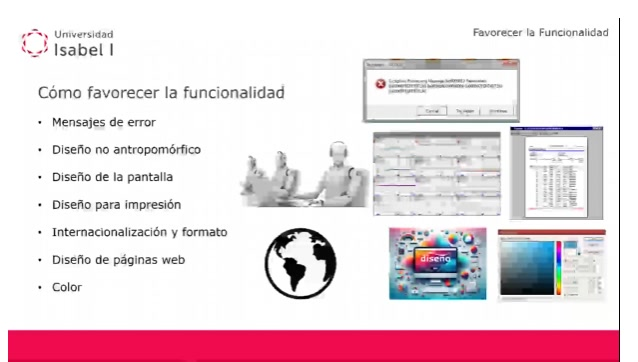
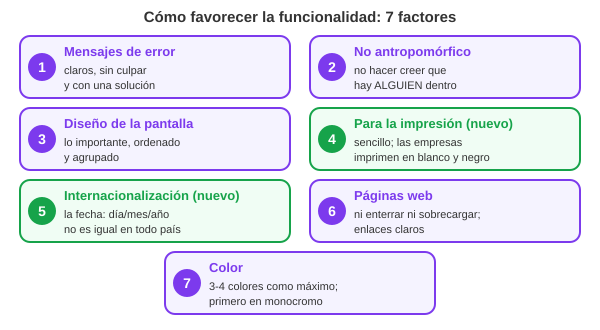

## Vídeo del profesor: favorecer la funcionalidad

> Vídeo: Esto sale del vídeo del profesor «UD3 - Favorecer la funcionalidad», que está en el campus (dura unos 18 minutos). Repasa los siete factores que hacen que un programa se use mejor y más rápido. Algunos ya están arriba en el tema; el vídeo añade dos que no estaban (el diseño para la impresión y la internacionalización) y muchos ejemplos. Si el vídeo lo ha puesto él, lo que cuenta ahí es lo que puede preguntar.

> Lo que pone la diapositiva: Título: Cómo favorecer la funcionalidad. Siete puntos: mensajes de error, diseño no antropomórfico, diseño de la pantalla, diseño para impresión, internacionalización y formato, diseño de páginas web y color. Al lado, imágenes de ejemplo: un mensaje de error lleno de códigos, dos personas junto a un robot, dos pantallas llenas de datos, un globo terráqueo, un cartel de colores con la palabra «diseño» y una paleta de colores.

Al final del vídeo el profesor dice para qué sirven los siete: para favorecer la funcionalidad del software, es decir, la productividad del usuario cuando lo usa.

> Qué ves en el dibujo: Siete tarjetas, una por factor, con la idea que hay que recordar de cada uno. Las de color morado ya estaban en el tema; las dos verdes (impresión e internacionalización) son lo nuevo que añade el vídeo.

### 1. Mensajes de error

Un mensaje de error aparece cuando no se puede hacer una acción o cuando el sistema está inestable. Lo que dice el mensaje puede generar estrés, así que tiene que ser:

- Sencillo, claro y conciso.
- Sin información que no le sirve al usuario.
- Sin echarle la culpa al usuario.
- Sin meterle prisa para que decida rápido.
- Con alguna sugerencia para resolver el problema, o para no volver a cometer el error.

Una idea que añade el vídeo: si se sabe con qué frecuencia sale cada error, los diseñadores pueden mejorar primero los mensajes más comunes. Y a veces pueden cambiar la propia interfaz para que el usuario deje de cometer ese error, si es él quien lo provoca.

El ejemplo del vídeo es un mensaje lleno de códigos técnicos. El usuario no lo entiende y además piensa que es algo muy grave, cuando quizá es un error pequeño.

> En el examen: Es lo que MÁS cae de este vídeo: mensajes de error, 12 preguntas en 6 exámenes. Las frases de la plantilla: siempre debe darse alguna indicación para tratar el problema; no tiene por qué ser extenso, debe ser útil y comprensible; ofrecer toda la información técnica NO ayuda; y un tono alarmista («grave», «crítico», un icono de peligro) aumenta la ansiedad.

### 2. Diseño no antropomórfico

Antropomórfico quiere decir «con forma humana»: un ordenador que habla como una persona, que tiene cara o que dice «yo».

- Durante un tiempo se intentó humanizar a los ordenadores. A los niños les gustaba, y a las personas mayores les quitaba el miedo.
- El problema: el usuario acaba pensando que hay ALGUIEN detrás de la pantalla, cuando solo hay ALGO.
- Cuando ve que el ordenador no le entiende ni le ayuda, se frustra. Y puede sentir que le han engañado.

Lo mejor es evitar el diseño antropomórfico. Así queda claro que la tecnología está al servicio de la persona y que no es una relación de igual a igual.

El vídeo dice que los asistentes con cara, voz y que hablan en primera persona suelen ser una distracción y caer en lo infantil. Si se usa un asistente así, tiene que ser lo más aséptico posible (neutro, sin hacerse el humano). Es la línea que siguen hoy Alexa o Siri.

> En el examen: Ha caído 1 vez (2501860): una interfaz antropomórfica es la que sugiere que los ordenadores pueden pensar, saber o comprender a las personas.

### 3. Diseño de la pantalla

- La estética visual es uno de los factores que más influyen en que el usuario esté satisfecho.
- Pero no hay medidas objetivas para decir si una interfaz es aceptable ni cuánto.
- Clave: que en cada momento se vean todos los datos importantes, de forma ordenada y lógica.
- Muy recomendable: agrupar los datos y los elementos que van juntos.
- El orden también importa: aunque estén agrupados, no pueden ir en cualquier orden.

El ejemplo del vídeo es una pantalla con muchísimos datos más o menos ordenados, que agobia al usuario. Es mejor enseñarle solo lo importante en cada momento, y no todo a la vez.

### 4. Diseño para la impresión (lo nuevo del vídeo)

El papel tiene muchas más limitaciones que una pantalla. Lo que hay que cuidar al imprimir:

- 1. Simplicidad como base.
- 2. Cohesión.
- 3. Adecuarse a la página: el tamaño del papel limita cuánta información cabe y cómo se reparte. El tipo de papel también condiciona el tamaño de letra y los colores. Ojo: en las empresas lo normal es imprimir en blanco y negro, así que los colores pueden hacer que no se lea bien.
- 4. Escala, contraste y proporción: que quede armónico y claro.
- 5. Organización y estructura: agrupar bien, poner jerarquías entre los datos y que los datos relacionados estén cerca, para que quede equilibrado.
- 6. Consistencia con la aplicación: se adapta al papel, pero tiene que parecerse a como se ve en la pantalla.
- 7. Sencillez: las imágenes y los gráficos no deben ser los protagonistas, porque algunas impresoras tienen poca resolución.
- 8. Integridad y completitud: toda la información importante tiene que caber en lo que se imprime.

> En el examen: La impresión ha salido 1 vez con otra pregunta (11212): los editores que enseñan cómo va a quedar el documento impreso, como Word, se llaman WYSIWYG, «lo que ves es lo que obtienes».

### 5. Internacionalización y formato (lo nuevo del vídeo)

La aplicación tiene que adaptarse al país del usuario. El ejemplo del vídeo es la fecha:

- En algunos países se escribe primero el mes, luego el día y luego el año.
- En España se escribe primero el día, luego el mes y luego el año.
- En algunos idiomas se usan los ordinales: «primero, segundo, tercero de mayo» en vez de «1, 2 y 3 de mayo».

Con números: el 3 de mayo de 2026 se escribe 03/05/2026 en España y 05/03/2026 en Estados Unidos. Si la aplicación no se adapta, un usuario español leería «5 de marzo».

> En el examen: La internacionalización ha caído 2 veces, siempre al revés: «¿de qué NO se encarga?». En el 11212, la internacionalización no se preocupa de la ubicación de los elementos en la pantalla. En el test del campus, no se encarga de las festividades y eventos culturales.

### 6. Diseño de páginas web: los errores más comunes

Muchas aplicaciones de escritorio se han cambiado por aplicaciones web. Por eso tienen que estar muy bien hechas. Los errores que repasa el vídeo:

- 1. Enterrar la información muy al fondo: hay que hacer mucho scroll por culpa de títulos, menús y anuncios.
- 2. Sobrecargar la página: páginas larguísimas, casi un capítulo de libro. Mejor paginar.
- 3. Navegación incómoda o confusa: botones de avanzar o volver camuflados por un diseño demasiado sofisticado.
- 4. Poner la información en sitios inesperados: lo importante va en la zona central, no a un lado ni abajo.
- 5. Enlaces que no se ven claros: con estilos que colorean todo, el usuario no sabe qué se puede pulsar.
- 6. Tablas mal diseñadas: muy pequeñas, sin la cabecera a la vista o con texto que no cabe.
- 7. Texto demasiado pequeño. El navegador tiene zoom, pero el tamaño por defecto tiene que ser bueno.
- 8. Colores de texto que no se leen: por ejemplo, texto rojo sobre fondo azul. En proyectores y monitores malos no se lee nada.
- 9. Formularios mal hechos: desordenados, con mal tamaño o dispersos por la página.
- 10. Ocultar o no dar las ayudas: información sobre dónde están las cosas o cómo llegar a un menú.

> En el examen: El rojo con azul ha caído 2 veces (11212 y 2501860): usar fuertes contrastes como rojo y azul en el texto es una MALA práctica, porque en pantallas y proyectores no se ven bien.

### 7. El color: las reglas básicas

El color es una gran herramienta, pero mal usado destroza la experiencia del usuario. Las reglas del vídeo:

- 1. Usarlo de forma conservadora: colores que no sean estridentes, para no cansar la vista.
- 2. Limitar el número: no más de 3 o 4 colores distintos en pantalla. Con más, se satura la vista y el usuario olvida qué significa cada uno.
- 3. Usar el color como código, para marcar estados o situaciones.
- 4. Que el código se pueda adaptar a la tarea. Ejemplo de la bolsa: si las acciones caen, los números van en rojo.
- 5. Que el código de colores se active solo, según la tarea.
- 6. Diseñar PRIMERO en monocromo (blanco y negro), con un lápiz, olvidándose de la paleta. Así la información queda bien organizada y luego es fácil imprimir o verla en pantallas sin color. El profesor dijo que es una regla muy antigua, muy sabia, y que casi nadie sigue.
- 7. Pensar en los usuarios daltónicos: cuidar el contraste para que, aunque no distingan el color, sepan si es claro u oscuro.
- 8. Usar el color para relacionar datos que van juntos: mismo origen, misma fecha, misma tarea.
- 9. Ser consistente: un color significa lo mismo en toda la aplicación.
- 10. Respetar lo que el usuario espera: verde para lo positivo y rojo para lo negativo.
- 11. Evitar las parejas de colores problemáticas.
- 12. Cambiar el color cuando cambia un estado, para que el usuario lo note.
- 13. Usar colores en los gráficos para que quepa más información y se entienda mejor.

> En el examen: La regla del monocromo ha caído 2 veces (11212 y 2302000), y con trampa: te preguntan cuál es una MALA regla. La respuesta es «diseñar primero para interfaz en color y después para pantallas monocromo». Es al revés de lo que hay que hacer: primero monocromo y luego color.

> Recuerda: Los siete factores en orden: mensajes de error, no antropomórfico, pantalla, impresión, internacionalización, web y color. Lo que más cae: los mensajes de error.
