Esta es la clase 4 de Cálculo, del 27 de octubre, con el profesor José María Torres Bruna. Es una clase de ejercicios de la Unidad 3 (derivadas). Hizo tres: un límite resuelto de dos maneras, un problema de optimización (una caja) y el estudio completo de la función f(x) = e^(−1/x) / x². Aquí está todo lo que hizo, paso a paso, con lo que él se salta explicado.

## Lo que dijo al empezar

- Estamos en el tema 3, derivadas. La semana que viene empieza el tema 4, integrales. Con eso se acaba el cálculo de una variable, que dijo que es parecido al de bachillerato.
- Del tema 5 en adelante: un poco de varias variables y un poco de métodos numéricos. Dijo que no da para mucho, porque es un trimestre.
- Lo más importante para el examen, según él: el estudio completo de una función, «donde hay un poquito de todo».

> En el examen: El profe lo repitió: el estudio completo de una función es lo que más puede caer y lo más parecido al examen. En los registros: preguntas de máximos y mínimos, 6 veces en 3 exámenes oficiales; de crecimiento, 3 veces; y la familia de funciones con e elevado a algo partido por x, 7 preguntas en el 2512770.

## Ejercicio 1: un límite con raíz, de dos maneras

$ lím (x→0) (√(x + 9) − 3) / x :: límite cuando x tiende a cero de raíz de x más nueve, menos tres, partido por x

### Paso 1: sustituir para ver qué pasa

Arriba:

$ √(0 + 9) − 3 = √9 − 3 :: raíz de nueve menos tres

$ √9 − 3 = 3 − 3 = 0 :: tres menos tres, cero

Abajo:

$ x = 0 :: cero

Sale 0 / 0. Es una indeterminación: con eso no se sabe el resultado y hay que hacer algo más.

Antes de seguir, una prueba con números para ver a qué se acerca. Con x = 0,01:

$ √(9,01) = 3,001666 :: raíz de nueve coma cero uno es tres coma cero cero uno seis seis seis

$ 3,001666 − 3 = 0,001666 :: le resto tres

$ 0,001666 / 0,01 = 0,1666 :: lo divido entre cero coma cero uno

0,1666 es casi 1/6. Ya sabemos a dónde tenemos que llegar.

### Manera 1: multiplicar por el conjugado (como en bachillerato)

El conjugado de √(x + 9) − 3 es lo mismo con el signo cambiado: √(x + 9) + 3. Se multiplica arriba y abajo por él, así la fracción no cambia.

Se usa esta identidad notable, que el profe escribió en la pizarra:

$ (a − b) · (a + b) = a² − b² :: a menos be por a más be, es a al cuadrado menos be al cuadrado

Con a = √(x + 9) y b = 3, arriba queda:

$ (√(x + 9))² − 3² :: raíz de x más nueve al cuadrado, menos tres al cuadrado

$ (x + 9) − 9 :: el cuadrado quita la raíz; tres al cuadrado es nueve

$ x :: el nueve se va con el menos nueve

Abajo se deja sin operar: x · (√(x + 9) + 3).

Ahora la x de arriba se tacha con la x de abajo:

$ lím (x→0) 1 / (√(x + 9) + 3) :: queda uno partido por raíz de x más nueve más tres

Ahora ya se puede sustituir x = 0:

$ 1 / (√9 + 3) :: uno partido por raíz de nueve más tres

$ 1 / (3 + 3) :: uno partido por tres más tres

$ 1 / 6 :: un sexto

### Manera 2: L'Hôpital (más rápido)

Como sale 0 / 0, se puede derivar arriba y abajo por separado (no es la regla del cociente: cada uno por su lado).

Derivada de arriba:

$ (√(x + 9))′ = 1 / (2 · √(x + 9)) :: la derivada de la raíz es uno partido por dos veces la raíz

$ (− 3)′ = 0 :: la derivada de un número es cero

Derivada de abajo:

$ (x)′ = 1 :: la derivada de x es uno

Queda:

$ lím (x→0) 1 / (2 · √(x + 9)) :: uno partido por dos raíz de x más nueve

$ 1 / (2 · √9) :: sustituyo x igual a cero

$ 1 / (2 · 3) :: raíz de nueve es tres

$ 1 / 6 :: un sexto

Sale lo mismo por los dos caminos. El profe dijo que L'Hôpital es más rápido y «más elegante».

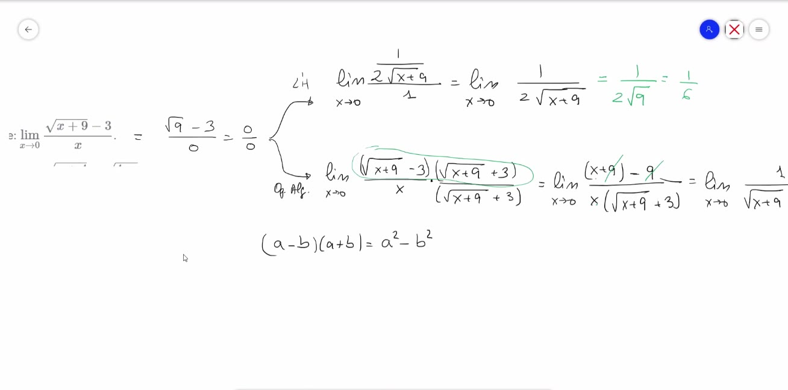

> Lo que pone la pizarra: Límite cuando x tiende a cero de raíz de x más nueve menos tres, partido por x. Igual a raíz de nueve menos tres partido por cero, igual a cero partido por cero. De ahí salen dos flechas. Arriba, L'Hôpital: límite de uno partido por dos raíz de x más nueve, partido por uno, igual a uno partido por dos raíz de nueve, igual a un sexto. Abajo, operaciones algebraicas: multiplica por raíz de x más nueve más tres, arriba y abajo; queda x más nueve menos nueve, partido por x por raíz de x más nueve más tres; y luego uno partido por raíz de x más nueve más tres. Debajo, la identidad: a menos be por a más be es igual a a cuadrado menos be cuadrado.

> En el examen: Un límite con raíz y 0/0 ha caído 1 vez en los registros (12052). Dónde falla mucha gente con L'Hôpital: hacer la derivada del cociente entero. No: se deriva el de arriba y el de abajo por separado.

## Ejercicio 2: optimización, la caja con el menor material

El enunciado: se quiere construir una caja de base cuadrada y sin tapa, con un volumen de 500 dm³. ¿Qué medidas debe tener para gastar el mínimo material?

Optimizar es buscar la mejor solución. Aquí, la caja que gasta menos material. Las derivadas sirven porque en un mínimo la derivada vale cero.

### Paso 1: poner nombre a las medidas

- b = el lado de la base (es cuadrada: b por b).
- h = la altura.

### Paso 2: lo que está fijo, el volumen

$ V = b² · h :: el volumen es la base por la altura: be al cuadrado por hache

$ b² · h = 500 :: tiene que ser quinientos

### Paso 3: lo que queremos hacer mínimo, el material

El material es la superficie de la caja. No tiene tapa, así que son 5 piezas:

- La base: un cuadrado de b por b. Es b².
- Los 4 laterales: cada uno es un rectángulo de b por h. Los cuatro son 4 · b · h.

$ S = b² + 4 · b · h :: la superficie es be al cuadrado más cuatro por be por hache

### Paso 4: dejar una sola letra

S tiene dos letras, b y h. Con el volumen despejo h:

$ h = 500 / b² :: hache es quinientos partido por be al cuadrado

El profe explicó por qué despeja h y no b: si despejas b te sale una raíz y la cuenta se pone más fea.

Lo meto en S:

$ S = b² + 4 · b · 500 / b² :: sustituyo hache

$ S = b² + 2000 · b / b² :: cuatro por quinientos son dos mil

$ S = b² + 2000 / b :: una be de arriba se va con una de abajo

### Paso 5: derivar e igualar a cero

$ S′ = 2b − 2000 / b² :: la derivada de be al cuadrado es dos be; la de dos mil partido por be es menos dos mil partido por be al cuadrado

$ 2b − 2000 / b² = 0 :: la igualo a cero

$ 2b = 2000 / b² :: paso el término al otro lado

$ 2b · b² = 2000 :: paso be al cuadrado multiplicando

$ 2b³ = 2000 :: be por be al cuadrado es be al cubo

$ b³ = 1000 :: divido entre dos

$ b = 10 :: porque diez por diez por diez es mil

### Paso 6: comprobar que es un mínimo y no un máximo

El profe probó un número a cada lado del 10 en la derivada.

Con b = 1 (a la izquierda):

$ S′(1) = 2 · 1 − 2000 / 1² :: dos menos dos mil

$ S′(1) = − 1998 :: negativo: la superficie baja

Con b = 20 (a la derecha):

$ S′(20) = 2 · 20 − 2000 / 20² :: cuarenta menos dos mil entre cuatrocientos

$ S′(20) = 40 − 5 :: dos mil entre cuatrocientos es cinco

$ S′(20) = 35 :: positivo: la superficie sube

Baja y luego sube: en b = 10 hay un mínimo.

La otra forma que dijo: la segunda derivada.

$ S″ = 2 + 4000 / b³ :: la segunda derivada

$ S″(10) = 2 + 4000 / 1000 = 2 + 4 = 6 :: positiva: es un mínimo

### Paso 7: la altura y el resultado

$ h = 500 / 10² :: quinientos entre diez al cuadrado

$ h = 500 / 100 = 5 :: cinco decímetros

La caja: base de 10 dm por 10 dm y altura de 5 dm.

Material que gasta:

$ S = 10² + 4 · 10 · 5 :: base más los cuatro laterales

$ S = 100 + 200 = 300 dm² :: trescientos decímetros cuadrados

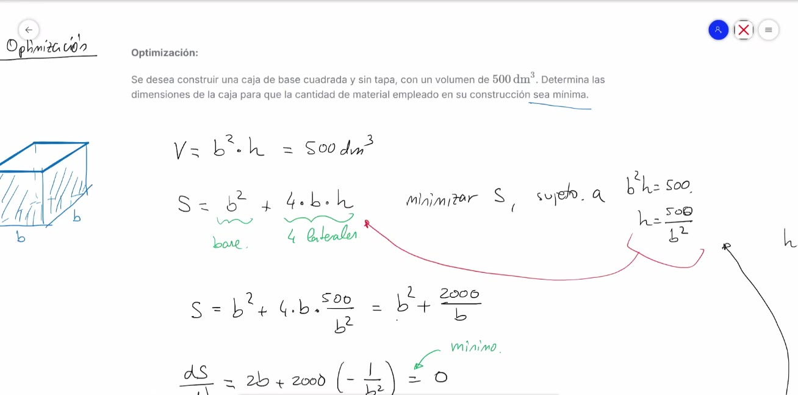

> Lo que pone la pizarra: Arriba, el enunciado de la optimización. A la izquierda, el dibujo de una caja sin tapa con base be por be. Volumen: be al cuadrado por hache igual a quinientos decímetros cúbicos. Superficie: be al cuadrado, la base, más cuatro por be por hache, los cuatro laterales. Minimizar ese, sujeto a be al cuadrado por hache igual a quinientos; hache igual a quinientos partido por be al cuadrado. Una flecha lleva la hache a la fórmula de ese: ese igual a be al cuadrado más cuatro por be por quinientos partido por be al cuadrado, igual a be al cuadrado más dos mil partido por be.

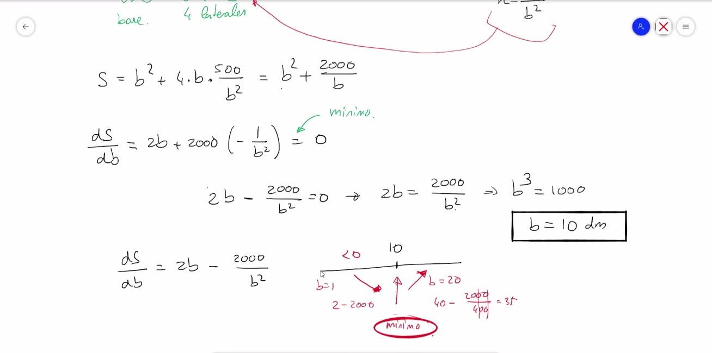

> Lo que pone la pizarra: De ese partido por de be igual a dos be más dos mil por menos uno partido por be al cuadrado, igual a cero (señalado: mínimo). Dos be menos dos mil partido por be al cuadrado igual a cero; dos be igual a dos mil partido por be al cuadrado; be al cubo igual a mil. Recuadro: be igual a diez decímetros. Debajo, una recta con el diez: a la izquierda, be igual a uno, dos menos dos mil, menor que cero, flecha que baja; a la derecha, be igual a veinte, cuarenta menos dos mil entre cuatrocientos, igual a treinta y cinco, flecha que sube. Rodeado: mínimo.

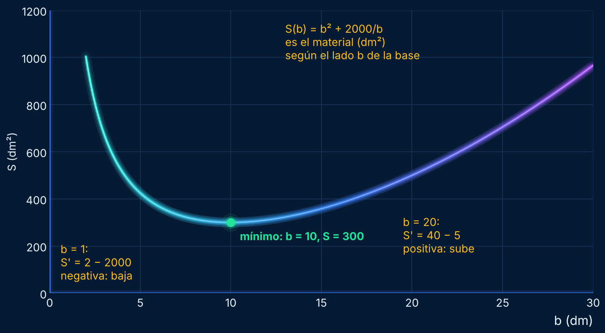

> Qué ves en el dibujo: La curva es el material que gasta la caja según el lado de la base. Con una base muy pequeña, la caja tiene que ser muy alta y gasta mucho. Con una base muy grande, también gasta mucho. El punto verde es el mínimo: base de 10, con 300 dm² de material.

> En el examen: Un problema de optimización como este NO ha caído en ningún examen registrado. Sí caen los máximos y mínimos de una función: 6 veces en 3 exámenes oficiales. La idea es la misma: derivada igual a cero y ver el signo a cada lado.

## Ejercicio 3: estudio completo de f(x) = e^(−1/x) / x²

$ f(x) = e^(−1/x) / x² :: efe de x es e elevado a menos uno partido por x, todo partido por x al cuadrado

Antes de empezar, dos cosas que el profe da por sabidas:

- e elevado a cualquier cosa es SIEMPRE positivo. Nunca da cero ni negativo.
- x² también es siempre positivo (si x no es 0).

Por eso esta función nunca es negativa. Se usa al final.

### Paso 1: el dominio

Los únicos problemas son los denominadores:

- En el exponente hay 1 / x: x no puede ser 0.
- Abajo hay x²: x no puede ser 0.

$ Dom f = ℝ − {0} :: todos los reales menos el cero

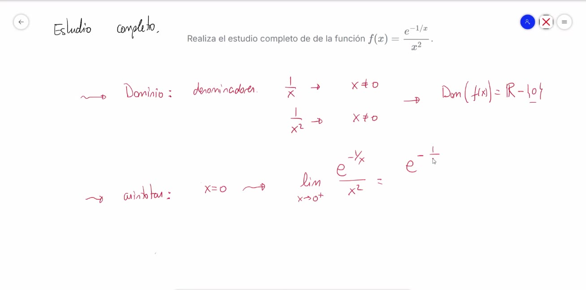

> Lo que pone la pizarra: Estudio completo. Realiza el estudio completo de la función f de x igual a e elevado a menos uno partido por x, partido por x al cuadrado. Dominio: denominadores. Uno partido por x, x distinto de cero. Uno partido por x al cuadrado, x distinto de cero. Dominio de f igual a erre menos el cero. Asíntotas: x igual a cero, límite cuando x tiende a cero por la derecha.

### Paso 2: la asíntota vertical en x = 0

Hay que mirar los dos lados del 0 por separado, porque salen cosas distintas.

#### Por la derecha (x → 0⁺): números como 0,1 o 0,01

Primero con números, para ver qué pasa en el exponente:

$ − 1 / 0,01 = − 100 :: menos uno entre cero coma cero uno es menos cien

$ e^(− 100) :: es un número pequeñísimo, casi cero

Sustituyendo, sale e^(−∞) / 0⁺, es decir 0 / 0. Indeterminación.

El profe aplicó L'Hôpital tal cual y vio que empeoraba: la x² de abajo pasó a ser x³. Cada vez que derivas aparece otra x más. Así no se acaba nunca.

El truco que hizo: darle la vuelta. Bajó la exponencial al denominador cambiando el signo del exponente, y subió 1 / x²:

$ e^(−1/x) / x² = (1 / x²) / e^(1/x) :: es la misma función escrita de otra forma

Ahora es ∞ / ∞. L'Hôpital una vez:

$ (1 / x²)′ = − 2 / x³ :: derivada de arriba

$ (e^(1/x))′ = e^(1/x) · (− 1 / x²) :: derivada de abajo: la exponencial por la derivada del exponente

$ (− 2 / x³) / (e^(1/x) · (− 1 / x²)) = 2 / (x · e^(1/x)) :: el menos con el menos se va; x al cubo entre x al cuadrado deja una x

Ahora es (1 / x) / e^(1/x) por 2. L'Hôpital otra vez:

$ (1 / x)′ = − 1 / x² :: derivada de arriba

$ (e^(1/x))′ = e^(1/x) · (− 1 / x²) :: derivada de abajo

$ lím (x→0⁺) 2 / e^(1/x) :: se tacha menos uno partido por x al cuadrado

$ 2 / e^(+∞) = 2 / ∞ = 0 :: dos entre un número enorme es cero

Por la derecha, la función se acerca a 0. Ahí NO sube al infinito.

Comprobación con números:

$ f(0,1) = e^(−10) / 0,01 :: e elevado a menos diez, entre cero coma cero uno

$ f(0,1) = 0,0000454 / 0,01 = 0,00454 :: casi cero

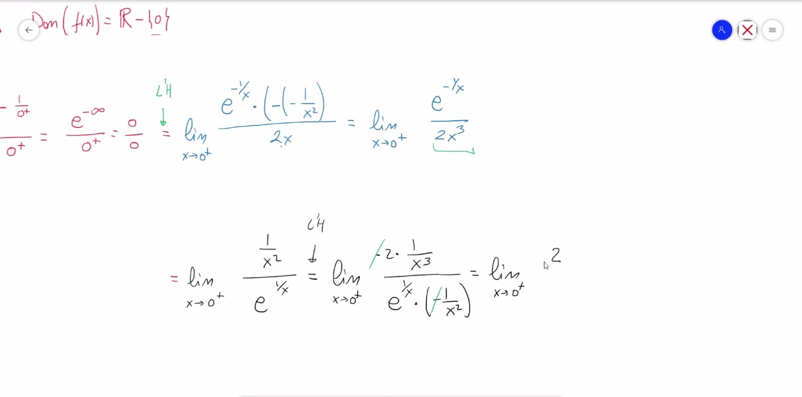

> Lo que pone la pizarra: Límite cuando x tiende a cero por la derecha: e elevado a menos uno partido por cero más, partido por cero más, igual a e elevado a menos infinito partido por cero más, igual a cero partido por cero. L'Hôpital: límite de e elevado a menos uno partido por x, por menos menos uno partido por x al cuadrado, partido por dos x; igual al límite de e elevado a menos uno partido por x partido por dos x al cubo (subrayado: empeora). Debajo, dado la vuelta: límite de uno partido por x al cuadrado, partido por e elevado a uno partido por x. L'Hôpital: menos dos por uno partido por x al cubo, partido por e elevado a uno partido por x por menos uno partido por x al cuadrado (tachados los menos).

#### Por la izquierda (x → 0⁻): números como −0,1 o −0,01

$ − 1 / (− 0,01) = + 100 :: menos entre menos da más: más cien

$ e^(100) :: es un número enorme

Abajo, x² con x negativo sale positivo y muy pequeño: 0⁺.

$ e^(+∞) / 0⁺ = + ∞ :: enorme entre casi cero, más infinito

Aquí no hay indeterminación. Por la izquierda la función sube a +∞.

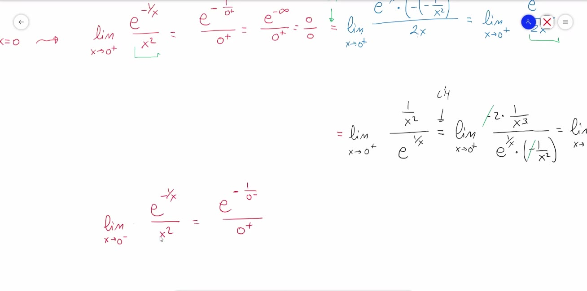

> Lo que pone la pizarra: Arriba, repetido el límite por la derecha. Debajo: límite cuando x tiende a cero por la izquierda de e elevado a menos uno partido por x, partido por x al cuadrado, igual a e elevado a menos uno partido por cero menos, partido por cero más.

> Recuerda: x = 0 es asíntota vertical solo por la izquierda (sube a +∞). Por la derecha la función se acerca a 0 y ahí hay un hueco en el (0, 0), porque el 0 no está en el dominio.

> Ojo: Dónde falla mucha gente: el signo de 1/x en 0⁻. Si x es negativo, −1/x es POSITIVO. Por eso e^(−1/x) se dispara por la izquierda y se apaga por la derecha.

### Paso 3: la primera derivada (crecimiento y máximo)

Es un cociente: (arriba)′ por abajo, menos arriba por (abajo)′, todo partido por abajo al cuadrado.

$ (e^(−1/x))′ = e^(−1/x) · (1 / x²) :: la exponencial por la derivada del exponente; la derivada de menos uno partido por x es uno partido por x al cuadrado

$ (x²)′ = 2x :: derivada de abajo

$ f′(x) = [e^(−1/x) · (1/x²) · x² − e^(−1/x) · 2x] / x⁴ :: la regla del cociente

$ f′(x) = [e^(−1/x) − e^(−1/x) · 2x] / x⁴ :: uno partido por x al cuadrado por x al cuadrado es uno

$ f′(x) = e^(−1/x) · (1 − 2x) / x⁴ :: saco factor común la exponencial

Igualo a cero. La exponencial nunca es cero y x⁴ está abajo, así que solo puede ser cero el paréntesis:

$ 1 − 2x = 0 :: el paréntesis igual a cero

$ 1 = 2x :: paso el dos x

$ x = 1/2 :: divido entre dos

Para el signo: e^(−1/x) y x⁴ son siempre positivos. Manda (1 − 2x). Pruebo un número en cada zona:

$ x = − 1 → 1 − 2 · (−1) = 1 + 2 = 3 :: positivo: crece

$ x = 0,25 → 1 − 2 · 0,25 = 1 − 0,5 = 0,5 :: positivo: crece

$ x = 1 → 1 − 2 · 1 = − 1 :: negativo: decrece

- De −∞ a 0: crece.
- En 0: no existe (NE).
- De 0 a 1/2: crece.
- En 1/2: máximo.
- De 1/2 a +∞: decrece.

El valor del máximo:

$ f(1/2) = e^(−1/(1/2)) / (1/2)² :: sustituyo un medio

$ − 1 / (1/2) = − 2 :: uno entre un medio es dos

$ (1/2)² = 1/4 :: un medio al cuadrado

$ f(1/2) = e^(−2) / (1/4) = 4 · e^(−2) :: dividir entre un cuarto es multiplicar por cuatro

$ f(1/2) = 4 / e² ≈ 0,54 :: cuatro entre e al cuadrado, cero coma cincuenta y cuatro

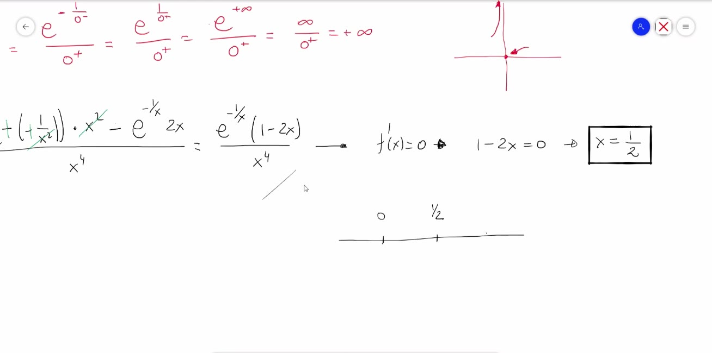

> Lo que pone la pizarra: Arriba, el límite por la izquierda: e elevado a menos uno partido por cero menos, igual a e elevado a uno partido por cero más, igual a e elevado a más infinito, partido por cero más, igual a infinito partido por cero más, igual a más infinito; al lado, un dibujito de la rama que sube. Debajo, la derivada: menos menos uno partido por x al cuadrado por x al cuadrado (tachados), menos e elevado a menos uno partido por x por dos x, partido por x a la cuarta; igual a e elevado a menos uno partido por x por uno menos dos x, partido por x a la cuarta. f prima igual a cero: uno menos dos x igual a cero. Recuadro: x igual a un medio. Una recta con el cero y el un medio.

### Paso 4: las asíntotas horizontales

$ lím (x→+∞) e^(−1/x) / x² = e^0 / ∞ = 1 / ∞ = 0 :: e elevado a cero es uno; uno entre infinito es cero

$ lím (x→−∞) e^(−1/x) / x² = e^0 / ∞ = 1 / ∞ = 0 :: igual: menos infinito al cuadrado es más infinito

Asíntota horizontal y = 0 por los dos lados. Como hay horizontal, no hay oblicua.

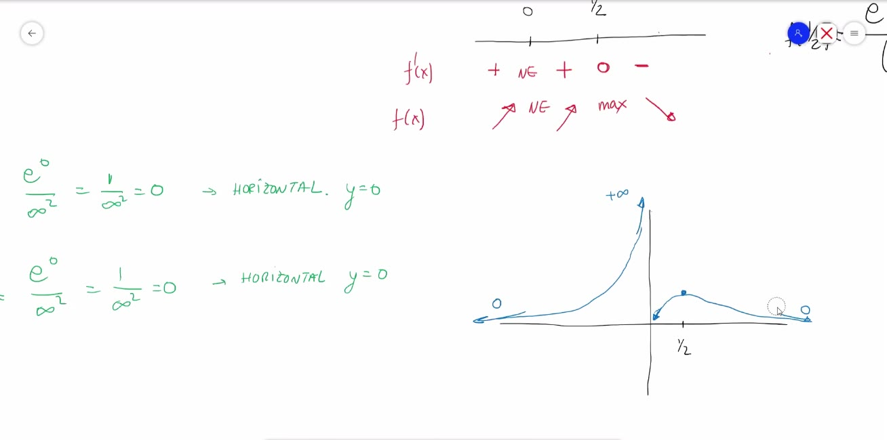

> Lo que pone la pizarra: Recta con el cero y el un medio. f prima: más, no existe, más, cero, menos. f de x: sube, no existe, sube, máximo, baja. A la izquierda, en verde: e elevado a cero partido por infinito al cuadrado, igual a uno partido por infinito al cuadrado, igual a cero: horizontal, y igual a cero; lo mismo en menos infinito: horizontal, y igual a cero. A la derecha, el dibujo de la función: por la izquierda viene pegada al cero y sube a más infinito junto al eje; por la derecha sale del cero, sube a un máximo en un medio y baja otra vez hacia cero.

### Paso 5: la segunda derivada (concavidad e inflexión)

El profe la calculó en directo y al final dijo que había algún error. Comprobó en el ordenador que la buena era otra, pero no la terminó. Aquí está bien hecha.

> Ojo: En la pizarra el profe llegó a e^(−1/x) · 2x² · (3x² − x − 1) / x⁸, y él mismo dijo que estaba mal. La segunda derivada correcta, la que leyó del ordenador al final, es la de abajo. Con ella salen DOS puntos de inflexión, no uno.

$ f″(x) = e^(−1/x) · (6x² − 6x + 1) / x⁶ :: efe segunda es e elevado a menos uno partido por x, por seis x cuadrado menos seis x más uno, partido por x a la sexta

La exponencial y x⁶ son siempre positivos. El signo lo decide 6x² − 6x + 1. Lo igualo a cero con la fórmula de segundo grado (a = 6, b = −6, c = 1):

$ Δ = b² − 4 · a · c :: el discriminante

$ Δ = 36 − 4 · 6 · 1 :: menos seis al cuadrado es treinta y seis

$ Δ = 36 − 24 = 12 :: doce

$ √12 ≈ 3,464 :: raíz de doce

$ x = (6 + 3,464) / 12 = 9,464 / 12 ≈ 0,79 :: la primera solución

$ x = (6 − 3,464) / 12 = 2,536 / 12 ≈ 0,21 :: la segunda solución

Pruebo un número en cada zona en 6x² − 6x + 1:

$ x = − 1 → 6 + 6 + 1 = 13 :: positivo: convexa, forma de U

$ x = 0,1 → 0,06 − 0,6 + 1 = 0,46 :: positivo: convexa, forma de U

$ x = 0,5 → 1,5 − 3 + 1 = − 0,5 :: negativo: cóncava, forma de ∩

$ x = 1 → 6 − 6 + 1 = 1 :: positivo: convexa, forma de U

- Hay dos puntos de inflexión: x ≈ 0,21 y x ≈ 0,79.
- Entre los dos, la curva tiene forma de ∩ (ahí está el máximo).
- Fuera de ellos, forma de U.

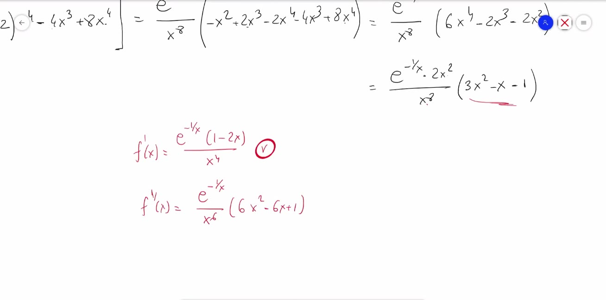

> Lo que pone la pizarra: Arriba, la cuenta larga del profe, que termina en e elevado a menos uno partido por x por dos x al cuadrado, partido por x a la octava, por tres x al cuadrado menos x menos uno. Debajo, comprobado con el ordenador: f prima de x igual a e elevado a menos uno partido por x por uno menos dos x, partido por x a la cuarta, con un visto bueno; y f segunda de x igual a e elevado a menos uno partido por x, partido por x a la sexta, por seis x al cuadrado menos seis x más uno.

> En el examen: El profe dijo que en el examen la segunda derivada se pide poco: o ponen una función más fácil, o no piden los puntos de inflexión. En los registros, la concavidad ha caído 1 vez (12052).

### Paso 6: el dibujo y el recorrido

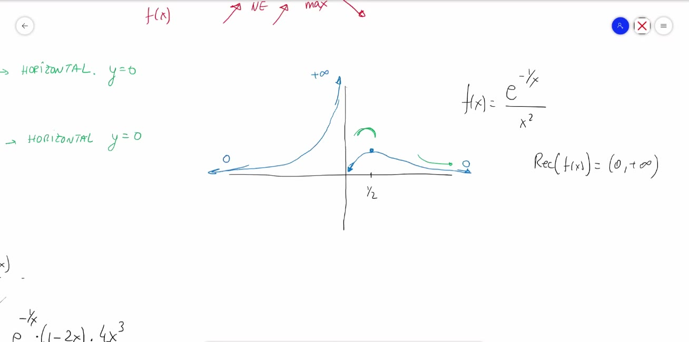

> Lo que pone la pizarra: El dibujo de la función, igual que antes, con un más infinito arriba junto al eje por la izquierda, un cero en cada extremo y el máximo en un medio. Al lado: f de x igual a e elevado a menos uno partido por x, partido por x al cuadrado. Recorrido de f igual al intervalo abierto de cero a más infinito.

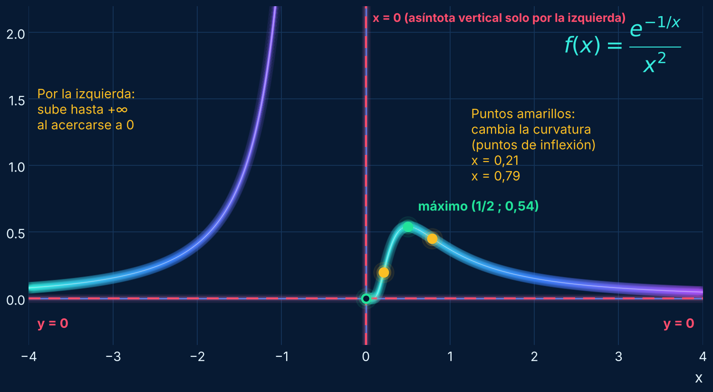

> Qué ves en el dibujo: Por la izquierda, la curva viene pegada al eje X (asíntota y = 0) y sube hasta el infinito al acercarse a x = 0. Por la derecha sale del punto hueco (0, 0), sube hasta el máximo en (1/2 ; 0,54) y vuelve a bajar hacia el eje X. Los dos puntos amarillos son los de inflexión: en 0,21 y en 0,79 la curva cambia de forma de U a forma de ∩ y al revés.

El recorrido son los valores que da la función (las y):

- Nunca es negativa: arriba una exponencial y abajo un cuadrado, los dos positivos.
- Nunca vale 0: se acerca, pero no llega.
- Por la izquierda sube hasta +∞.

$ Rec f = (0, +∞) :: el recorrido es de cero a más infinito, sin el cero

Tampoco corta los ejes: no corta el eje Y porque el 0 no está en el dominio, y no corta el eje X porque la función nunca vale 0.

### Resumen del estudio

- Dominio: ℝ − {0}.
- Cortes con los ejes: ninguno.
- Asíntota vertical: x = 0, solo por la izquierda (+∞). Por la derecha se acerca a 0.
- Asíntota horizontal: y = 0 por los dos lados.
- Crece en (−∞, 0) y en (0, 1/2). Decrece en (1/2, +∞).
- Máximo en (1/2 ; 4/e²), es decir, (0,5 ; 0,54).
- Inflexión en x ≈ 0,21 y x ≈ 0,79.
- Recorrido: (0, +∞).

> En el examen: Funciones con e elevado a algo partido por x han caído con −(1/x⁴)·e^(1/x³) en el 2512770 (7 preguntas de la misma función). Se hace igual que esta: mirar 0⁺ y 0⁻ por separado.

## Lo que viene

- La semana que viene: integrales y su aplicación principal, el área entre curvas.
- Dijo que esta misma función es fácil de integrar con el cambio de variable 1/x = t.
- Hará más funciones completas para repasar: dominio, recorrido, máximos, mínimos, crecimiento.
