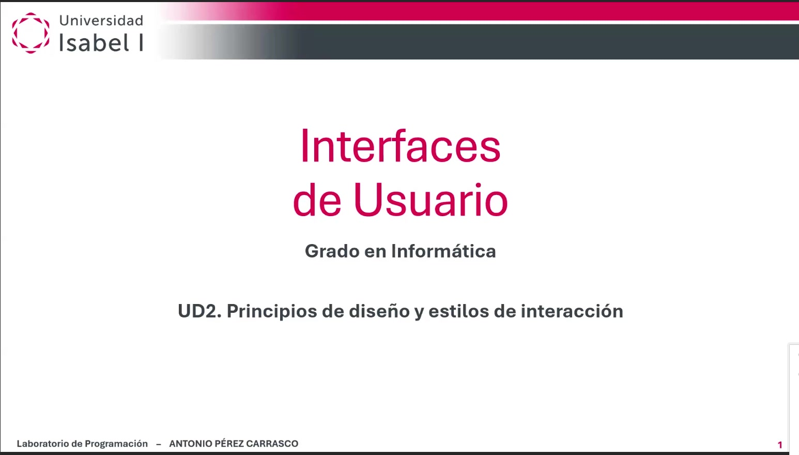
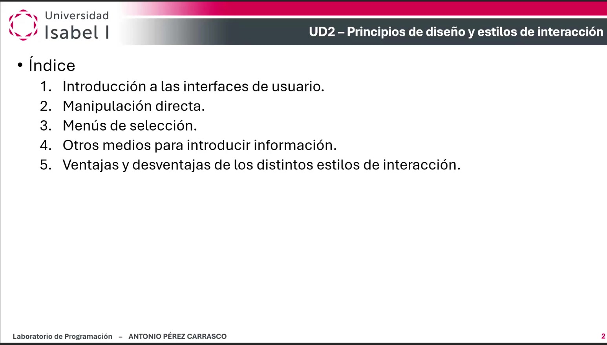
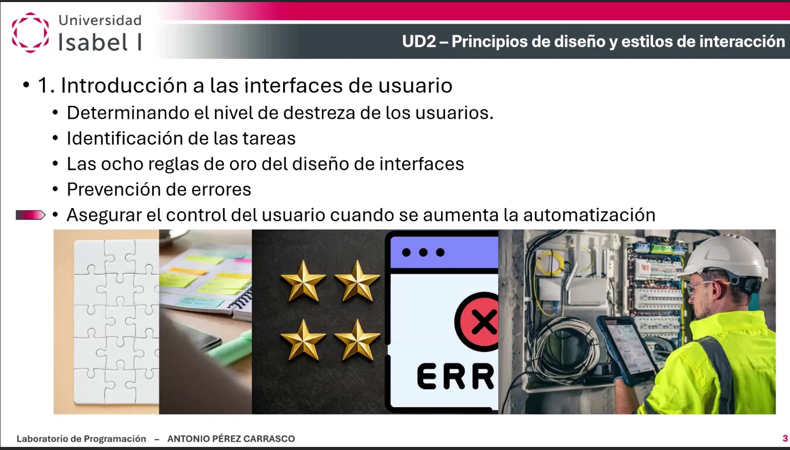
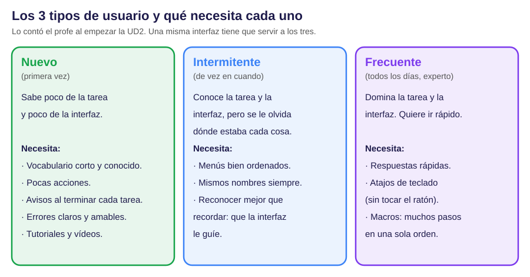
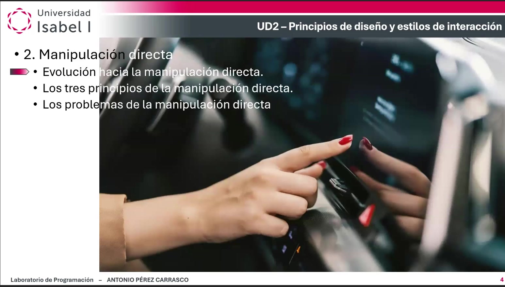
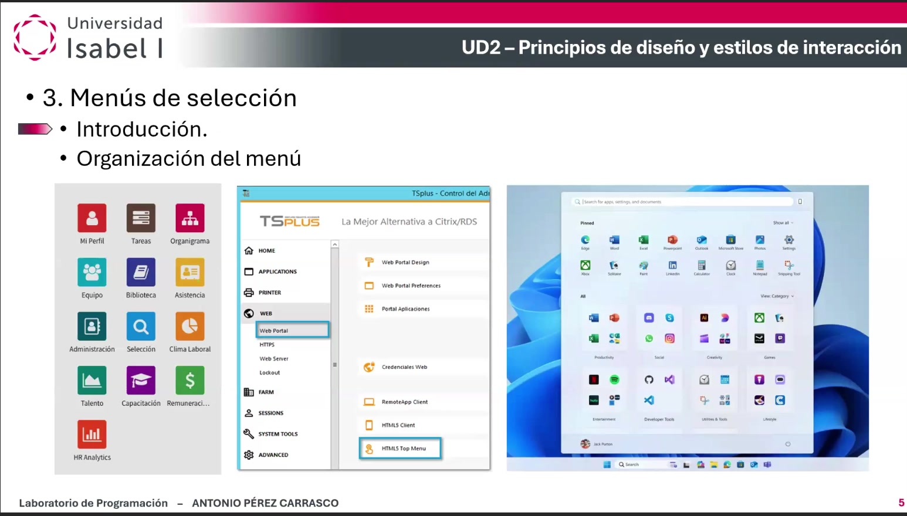
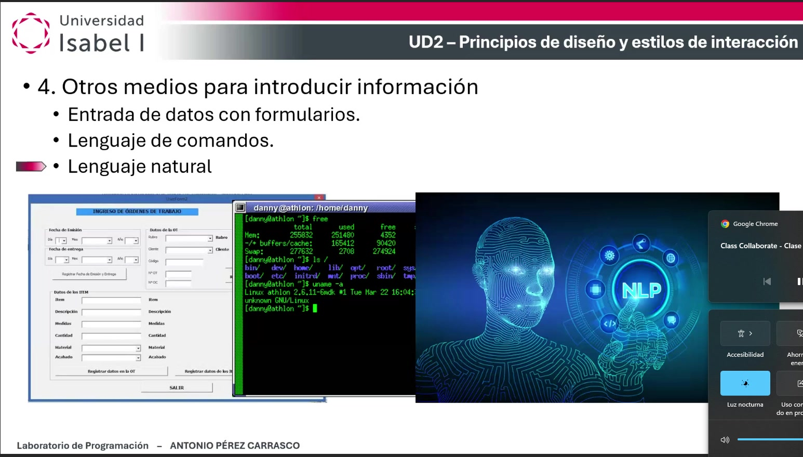
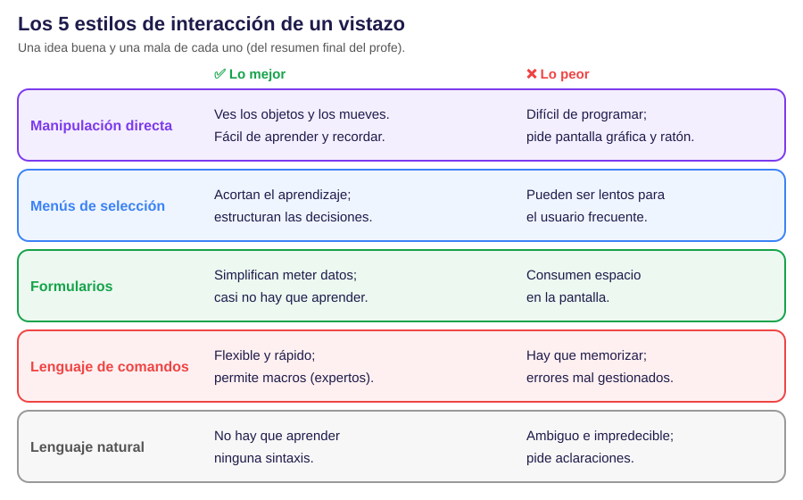
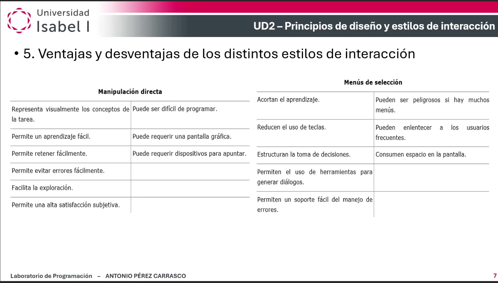
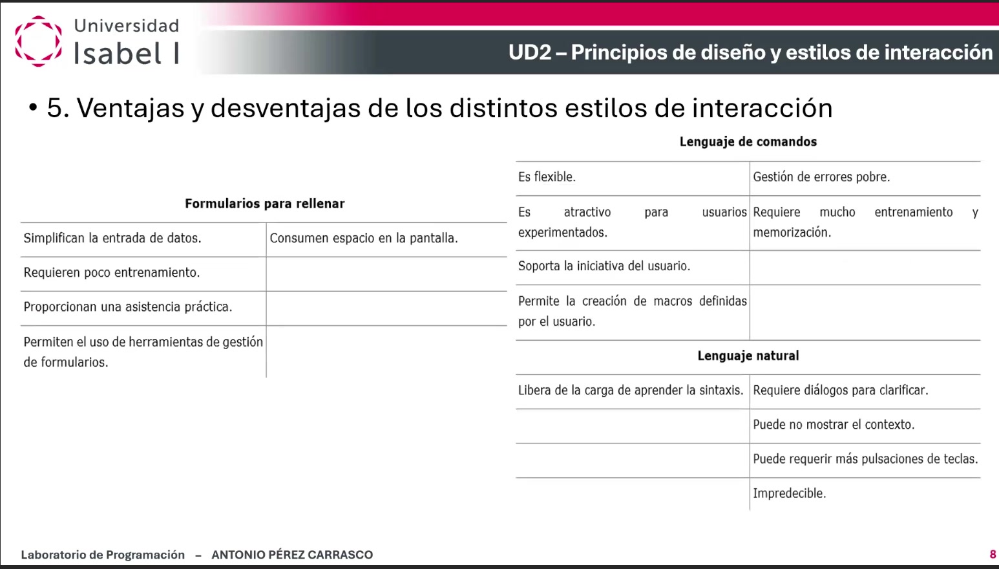

Esta es la clase 3 de Interfaces de Usuario, con el profesor Antonio Pérez Carrasco (viernes 23 de octubre, regrabada). Empieza la Unidad 2: principios de diseño y estilos de interacción. Aquí está ordenado y explicado todo lo que dijo.

## Dónde estamos

- Las clases 1 y 2 fueron la Unidad 1. Con esta clase empieza la Unidad 2.
- La Unidad 2 trata de dos cosas: cómo diseñar bien (los principios) y las formas que tiene el usuario de hablar con el programa (los estilos de interacción).
- La próxima clase es la 4, el viernes 30 de octubre, y será de la Unidad 3.

> Ojo: en esta clase el profe no habló de ningún trabajo ni de ninguna entrega. Todo fue explicación de la Unidad 2.

> Lo que pone la diapositiva: Interfaces de Usuario. Grado en Informática. UD2, Principios de diseño y estilos de interacción.

> Lo que pone la diapositiva: Índice. Uno: Introducción a las interfaces de usuario. Dos: Manipulación directa. Tres: Menús de selección. Cuatro: Otros medios para introducir información. Cinco: Ventajas y desventajas de los distintos estilos de interacción.

## 1. Conocer a los usuarios

La idea de partida: cada persona aprende, piensa y resuelve problemas a su manera.

- A unos les gustan las tablas y a otros los gráficos.
- Unos prefieren palabras y otros números.
- Unos quieren todo muy ordenado y otros más libre.

Por eso, antes de diseñar hay que conocer el perfil de quien va a usar el programa. El perfil depende de muchas cosas:

- Edad y género.
- Habilidades físicas y cognitivas (de pensar y recordar).
- Estudios, cultura y origen.
- Experiencia previa con ordenadores.
- Motivación y objetivos.
- Dónde vive (país, ciudad o pueblo), dinero que tiene y cómo ve la tecnología.

El profe insistió en que conocer al usuario no se acaba nunca: siempre hay algo más que investigar. Y que en las webs y en el móvil es todavía más difícil, porque los usa casi todo el mundo.

> Lo que pone la diapositiva: Uno, Introducción a las interfaces de usuario. Determinando el nivel de destreza de los usuarios. Identificación de las tareas. Las ocho reglas de oro del diseño de interfaces. Prevención de errores. Asegurar el control del usuario cuando se aumenta la automatización.

### 1.1. Los 3 tipos de usuario según cuánto usan el programa

> Qué ves en el dibujo: tres cajas. En verde, el usuario nuevo. En azul, el intermitente. En morado, el frecuente. Debajo de cada uno, lo que necesita.

### Usuario nuevo (primera vez)

- Sabe poco de la tarea y poco de la interfaz.
- A veces es un profesional que sí conoce la tarea. Entonces lo único que le falta es aprender a manejar la interfaz.
- Qué necesita:
- 1. Pocas palabras, conocidas, y siempre las mismas para lo mismo.
- 2. Pocas acciones, para que haga tareas sencillas y le salgan bien.
- 3. Un aviso cuando termina cada tarea (retroalimentación).
- 4. Mensajes de error concretos y que ayuden.
- 5. Buena documentación: texto, fotos, vídeos y tutoriales interactivos.

Así no le sube la ansiedad, confía en el sistema y le apetece seguir usándolo.

### Usuario intermitente (de vez en cuando)

- Conoce la tarea y conoce la interfaz.
- Pero como la usa poco, se le olvida dónde estaba cada opción. Al profe le pasa, y a todos.
- Qué necesita:
- 1. Menús bien ordenados.
- 2. Los mismos nombres siempre (consistencia).
- 3. Que la interfaz le guíe: reconocer es más fácil que recordar.

> Recuerda: «reconocer mejor que recordar» quiere decir que la opción se vea en pantalla y el usuario la encuentre, en vez de tener que acordarse de memoria.

### Usuario frecuente (todos los días, experto)

- Domina la tarea y la interfaz. Quiere trabajar rápido.
- Qué necesita:
- 1. Respuestas rápidas del programa.
- 2. Atajos de teclado, para no tener que coger el ratón ni buscar menús.
- 3. Macros: guardar una serie de pasos que repite mucho y lanzarlos todos juntos con una sola orden.

### Cómo se diseña para los tres a la vez

- Diseñar para un solo tipo es más o menos fácil. Para los tres es mucho más difícil.
- Lo bueno para uno suele ser bueno para todos: la memoria de todos funciona igual.
- El usuario nuevo empieza con lo mínimo, sin muchas opciones. Así es difícil equivocarse.
- Poco a poco pasa a niveles más altos: más opciones, más configuración. Así se va haciendo experto y adapta la interfaz a su gusto.

> Recuerda: es la misma idea del diseño por capas que el profe explicó en la clase 2.

### 1.2. Identificar las tareas

Cuando ya sabes quién es el usuario, el siguiente paso es saber qué tareas va a hacer.

Una tarea se parte en niveles:

- 1. Acciones de alto nivel (lo que quiere conseguir).
- 2. Acciones más concretas.
- 3. Acciones atómicas: las más pequeñas, que se hacen con un solo clic, una tecla o un botón.

El problema es elegir bien esas acciones pequeñas:

- Si hay muy pocas, el usuario tiene que encadenar muchos pasos para algo sencillo. Se desespera.
- Si hay demasiadas y muy complicadas, la interfaz se llena de opciones y el usuario no sabe cómo hacer lo que quiere.

La clave es la frecuencia de uso:

- Lo que se usa mucho tiene que estar a mano. Ejemplo del profe en Word: un botón siempre visible o una tecla como Control más una letra.
- Lo que se usa poco va más escondido: dentro de un menú o de un submenú, y luego un cuadro de diálogo que pide datos.
- No es esconderlo por esconder. Es para que no estorbe en el día a día.

> En el examen: en los registros hay 3 preguntas sobre la frecuencia de uso (en 3 exámenes distintos). La respuesta correcta siempre dice que sí se tiene en cuenta: lo que más se usa va en los menús de forma rápida y fácil. Ordenar por frecuencia es una práctica muy buena, sobre todo en el móvil.

### 1.3. Las 8 reglas de oro del diseño de interfaces

Son principios clásicos, muy aceptados, que llevan décadas mejorándose. No son una receta perfecta, pero evitan muchos errores del pasado.

- 1. Consistencia. Lo mismo se llama siempre igual. Un color siempre significa lo mismo. Todas las pantallas se organizan igual. Así el usuario se siente en terreno conocido.
- 2. Usabilidad universal. Una interfaz flexible que sirva al que empieza y al que domina. Explicaciones para los nuevos y atajos para los expertos.
- 3. Retroalimentación clara. Cada acción tiene una respuesta del sistema. Discreta para lo de todos los días y más visible para lo importante.
- 4. Diálogos cerrados. Agrupar las acciones en pasos con principio y final, y avisar al terminar. El usuario sabe en qué paso está, cuántos le quedan y que puede volver atrás o cancelar.
- 5. Prevenir errores. Que el sistema no deje equivocarse de forma grave. Y si pasa, que explique cómo arreglarlo de forma sencilla.
- 6. Permitir deshacer. Si sabe que puede volver atrás, tiene menos ansiedad y se anima a explorar.
- 7. Que el usuario sienta que tiene el control. Nada de sorpresas ni cambios raros en algo que ya conoce.
- 8. Reducir la carga de la memoria a corto plazo. No hacerle recordar datos de una pantalla a otra ni pedirle otra vez lo que ya metió.

Los ejemplos del profe, uno por línea:

- Regla 3, lo discreto: al guardar en Word, arriba en la ventana pone que está guardado. No sale ningún cuadro ni hay que darle a aceptar.
- Regla 3, lo importante: al acabar una búsqueda o una operación especial, Word sí avisa con un mensaje.
- Regla 5: si un campo es un número, no se debe poder escribir texto.
- Regla 7: si una función suele tardar 5 segundos, puede tardar 4 o 6, pero no 30 de repente.

> En el examen: en los registros no hay ninguna pregunta que diga «reglas de oro» con esas palabras. Pero sí caen sus ideas sueltas, sobre todo la de prevenir errores (mira el apartado siguiente).

### 1.4. Prevenir los errores

El profe dijo que este punto es tan importante que merece atención aparte. Los usuarios se equivocan mucho más de lo que imaginamos, y eso les quita productividad.

Primera ayuda: mejores mensajes de error.

- Un buen mensaje es concreto, claro y con un tono que ayuda, sin alarmar.
- Mal ejemplo: un mensaje que solo dice «Error». El usuario no sabe qué ha pasado ni qué hacer.
- Otro mal ejemplo: «Operación ilegal». Parece que va a venir la policía, bromeó el profe.

Pero lo de verdad eficaz es que el error no llegue a pasar:

- 1. Desactivar (poner en gris) los botones y opciones que no se pueden usar en ese momento.
- 2. Elegir en vez de escribir. Ejemplo: un calendario para la fecha. Si se escribe a mano, alguien pone que febrero tiene 57 días.
- 3. Juntar en una sola acción los pasos que siempre van juntos, para que no se olvide ninguno.

> En el examen: es lo que más cae de esta clase. En los registros hay 12 preguntas sobre errores, en 6 exámenes distintos. Lo que dan como correcto: es mejor evitar los errores (por ejemplo, dejar inactivos los botones que no se deben usar); un mensaje con tono alarmista (icono de peligro, palabras como «grave» o «crítico») aumenta la ansiedad; y enseñar datos técnicos que el usuario no puede usar (como una dirección de memoria) es innecesario.

### 1.5. El control del usuario cuando se automatiza

- Automatizar lo repetitivo es buena idea: menos trabajo y menos errores.
- Pero aunque se automatice, la interfaz tiene que seguir siendo predecible y controlable.
- Si el usuario lanza un proceso largo, quiere saber cómo va y poder pararlo.
- La persona sigue siendo imprescindible como supervisora. El mundo real está lleno de sorpresas y las máquinas solo funcionan bien en los casos normales para los que se programaron. Cuando pasa algo raro, decide una persona.

## 2. Manipulación directa

> Lo que pone la diapositiva: Dos, Manipulación directa. Evolución de la manipulación directa. Los tres principios de la manipulación directa. Los problemas de la manipulación directa. Debajo, una foto de un dedo tocando una pantalla.

### 2.1. Cómo se llegó hasta aquí: los procesadores de texto

El profe lo explicó con la historia de los editores de texto, paso a paso:

- 1. Años 80: solo veías una línea, la de abajo, la que estabas escribiendo. Para todo había que escribir órdenes.
- 2. Editores de pantalla completa: ya se veían más líneas, pero todavía dependías de órdenes. Ejemplo: el editor vi de Linux.
- 3. Editores como WordPerfect: ya te movías libremente por el documento y veías cómo iba quedando.
- 4. Años 90: llega WYSIWYG, «lo que ves es lo que obtienes». Ves la página entera tal y como saldrá impresa.

Ventajas de WYSIWYG: ves la página completa en su contexto, sabes cómo quedará al imprimir y no tienes que pelearte con órdenes. Después la idea pasó a las hojas de cálculo, las presentaciones, los enlaces de las webs y los correctores que subrayan en rojo al momento.

### 2.2. Los 3 principios de la manipulación directa

- 1. Ves siempre en pantalla los objetos y las acciones, con dibujos (metáforas) claros que se entienden sin pensar mucho.
- 2. En vez de escribir órdenes complicadas, haces acciones físicas sencillas: un clic, arrastrar, un gesto.
- 3. Las acciones son rápidas, se pueden deshacer y el resultado se ve al momento.

El ejemplo del profe: para borrar un archivo, lo coges con el ratón y lo sueltas en la papelera. Es igual que tirar un papel a la papelera de tu mesa.

Con estos 3 principios la interfaz sirve a casi cualquier usuario: el nuevo ve lo que pasa y el experto va rápido.

> En el examen: en los registros hay 4 preguntas sobre manipulación directa, en 4 exámenes distintos. Dos veces salió «¿cuál NO es un principio de la manipulación directa?»: la respuesta es la de los guantes con sensores para saber los gestos del usuario. Eso no es ninguno de los 3 principios.

### 2.3. Los problemas de la manipulación directa

- 1. Lo visual no siempre es mejor. Una persona ciega o con poca visión se maneja mejor con texto. Los lectores de pantalla ayudan, pero no sustituyen una interfaz pensada para ella.
- 2. Ocupa mucho espacio. Con muchos iconos y botones, lo importante se queda fuera de la pantalla. Ejemplo del profe: un experto prefiere ver 50 nombres de archivo en texto que 10 iconos con el nombre cortado.
- 3. Un dibujo puede hacer creer que algo se puede hacer cuando no se puede. Por eso hay que probar mucho los diseños con usuarios.
- 4. En el móvil el dedo tapa parte de la pantalla y los iconos pequeños cuestan de tocar, sobre todo a las personas mayores.
- 5. No siempre se puede responder al momento. Si consultar una base de datos tarda unos segundos, hay que enseñar una ruedita o una barra de progreso para que se sepa que el programa está trabajando y no colgado.
- 6. Deshacer no siempre es posible. Ejemplo del profe: un correo enviado ya no se puede recuperar del buzón de la otra persona.

> En el examen: salió para quién es un inconveniente la manipulación directa. La respuesta: los mecanógrafos expertos, que escriben muy rápido y tienen que parar para coger el ratón.

## 3. Menús de selección

> Lo que pone la diapositiva: Tres, Menús de selección. Introducción. Organización del menú. Debajo, capturas de menús de distintos programas, de una web y del menú de inicio de Windows.

- Los menús hacen que el usuario reconozca la opción en vez de tener que recordar una orden.
- Por eso van muy bien a quien tiene poca experiencia o usa el programa de vez en cuando: va mirando y encuentra las cosas.
- También ordenan las decisiones: cada menú es un bloque de funciones.
- No son solo para principiantes. Si están bien hechos (sin sobrecargar, claros, sin ambigüedad), los expertos también los usan rápido.

### 3.1. La organización es lo primero

- Un menú, un formulario o un cuadro de diálogo tiene que tener una organización con sentido: clara, fácil de recordar y que encaje con la tarea.
- Las estructuras en árbol (menús con submenús) funcionan bien porque cada opción está en un solo sitio.
- Si una opción aparece repetida en varios sitios, el árbol se convierte en una red liada. Hay que evitarlo.

> En el examen: salió «el primer paso para hacer los menús es…» y la respuesta es crear una organización razonable. También salió que los menús pueden tener submenús para ordenar las opciones por niveles. En total, 4 preguntas de menús en 3 exámenes de los registros.

### 3.2. Los menús en el móvil

- En el móvil manda la sencillez, y el criterio principal es la frecuencia de uso.
- Ejemplo del profe con los contactos: añadir un contacto es muy habitual, así que el botón «+» está siempre a la vista.
- Borrar un contacto es raro. Hay que abrir el contacto, editarlo, ir abajo del todo y confirmar.
- Está bien que borrar esté escondido y pida confirmación: no se puede deshacer y así no se hace sin querer.

### 3.3. Tipos de menú

- Menús de pocas opciones (2 o 3): cuidado con la opción que viene marcada por defecto, para no llevar al usuario a la equivocada.
- Casillas de verificación: para elegir varias opciones a la vez.
- Botones de opción (los redondos): para elegir solo una.
- Menús desplegables: los de arriba de la ventana. Casi todos los programas de escritorio los tienen. La opción en la que estás se marca.
- Las opciones desactivadas se ven en gris, pero no desaparecen. Así el usuario sabe que existen y que ahora no se pueden usar, y no se pone a buscarlas.
- Menús contextuales: salen con el botón derecho o al mantener pulsado. Tienen pocas opciones, solo las del objeto que has tocado. Ahorran ir a buscar cosas por la pantalla.
- En las webs, los menús evitan tener que bajar y bajar con la rueda sin fin.

## 4. Otros medios para introducir información

> Lo que pone la diapositiva: Cuatro, Otros medios para introducir información. Entrada de datos con formularios. Lenguaje de comandos. Lenguaje natural. Debajo, un formulario de escritorio, una pantalla negra con órdenes en verde y un dibujo de una cabeza digital con las letras NLP.

### 4.1. Formularios

Sirven para meter muchos datos de una vez. Cómo tiene que ser un buen formulario:

- 1. Un título claro que diga de qué va.
- 2. Instrucciones cortas, con palabras de todos los días.
- 3. Campos agrupados con lógica y en el orden natural. Ejemplo del billete de tren: primero la fecha de ida y después la de vuelta.
- 4. En una dirección, de lo más concreto a lo más general: calle, número, piso, ciudad, provincia y país.
- 5. Ordenado a la vista: etiquetas alineadas y espacio suficiente para que no agobie.
- 6. Que no deje meter datos imposibles. Si solo valen números positivos, no deja escribir letras ni el signo menos.
- 7. Mensajes de error que digan qué campo está mal, qué se ha escrito y qué se esperaba. Nada de «datos incorrectos» sin más.
- 8. Si no se puede avisar al momento, al menos al pulsar «Enviar» se dice qué campos fallan y por qué.
- 9. Si tiene varias pantallas, los botones intermedios dicen «Continuar» y el último «Enviar» o «Finalizar». Así sabe que ya ha terminado.
- 10. El cuadro del formulario se tiene que distinguir del resto de la pantalla, pero sin tapar lo que el usuario pueda necesitar ver.

> En el examen: en los registros hay 3 preguntas de formularios en 3 exámenes. Precargar los datos ya conocidos es buena idea. Los campos obligatorios se marcan con un asterisco. No es recomendable dejar sin marcar cuáles son obligatorios.

### 4.2. Lenguaje de comandos

- Son las órdenes escritas. Se siguen usando hoy para muchas cosas: editar texto, gestionar sistemas, consultar datos o enviar correos.
- Están pensados para expertos. Un usuario nuevo no se sabe las órdenes y va inseguro.
- Ejemplo del profe: los servidores de páginas web. Muchas veces no tienen ventanas ni iconos. Arrancas y solo ves un cursor esperando órdenes. Todo se hace escribiendo.
- Para el experto es lo más productivo: puede crear macros y programas pequeños (scripts) que hacen muchos pasos solos.

El profe dijo que los comandos se organizan de 3 maneras:

- 1. Una orden para cada cosa. Si hay pocas órdenes, es fácil de aprender.
- 2. Órdenes con argumentos, que dicen sobre qué se trabaja. Ejemplo: copiar, diciendo cuál es el archivo original y cómo se llama la copia.
- 3. Órdenes en forma de árbol, siempre en el mismo orden: primero la acción, luego el objeto y después el destino.

> En el examen: en los registros hay 9 preguntas de comandos, en 5 exámenes. La ventaja que dan como correcta: da sensación de control y agilidad al usuario experto o habitual. Y salió que LaTeX es un lenguaje de comandos para hacer documentos.

### 4.3. Lenguaje natural

- Es hablar con el programa como hablamos entre personas. Hoy ya es normal con los chats de inteligencia artificial.
- Ventaja: no hay que aprender órdenes ni buscar en menús. Va muy bien al que llega nuevo.
- Problemas:
- 1. El lenguaje humano es ambiguo. Las traducciones automáticas han mejorado mucho, pero el humor, la ironía o la poesía todavía no salen bien.
- 2. No queda claro qué se le puede pedir y qué no. Una interfaz visual te enseña las opciones; una conversación no, y tienes que imaginarte cómo funciona por dentro.
- 3. Si no entiende algo, empieza a pedir aclaraciones, y eso frustra.
- 4. A veces la inteligencia artificial se inventa cosas.
- 5. Escribir es lento. El ordenador enseña información mucho más rápido de lo que nosotros tecleamos, así que muchas veces es mejor enseñar opciones y que el usuario elija.
- Lo mejor, según el profe: combinar el lenguaje natural con elementos visuales.

## 5. Ventajas y desventajas de cada estilo

El profe cerró la clase con dos tablas resumen. Dijo que se centraba sobre todo en las ventajas.

> Qué ves en el dibujo: una fila por cada estilo. En el centro, lo mejor de cada uno, en verde. A la derecha, lo peor, en rojo.

> Lo que pone la diapositiva: Manipulación directa. Ventajas: representa visualmente los conceptos de la tarea; permite un aprendizaje fácil; permite retener fácilmente; permite evitar errores fácilmente; facilita la exploración; permite una alta satisfacción subjetiva. Desventajas: puede ser difícil de programar; puede requerir una pantalla gráfica; puede requerir dispositivos para apuntar. Menús de selección. Ventajas: acortan el aprendizaje; reducen el uso de teclas; estructuran la toma de decisiones; permiten el uso de herramientas para generar diálogos; permiten un soporte fácil del manejo de errores. Desventajas: pueden ser peligrosos si hay muchos menús; pueden enlentecer a los usuarios frecuentes; consumen espacio en la pantalla.

> Lo que pone la diapositiva: Formularios para rellenar. Ventajas: simplifican la entrada de datos; requieren poco entrenamiento; proporcionan una asistencia práctica; permiten el uso de herramientas de gestión de formularios. Desventaja: consumen espacio en la pantalla. Lenguaje de comandos. Ventajas: es flexible; es atractivo para usuarios experimentados; soporta la iniciativa del usuario; permite la creación de macros definidas por el usuario. Desventajas: gestión de errores pobre; requiere mucho entrenamiento y memorización. Lenguaje natural. Ventaja: libera de la carga de aprender la sintaxis. Desventajas: requiere diálogos para clarificar; puede no mostrar el contexto; puede requerir más pulsaciones de teclas; impredecible.

> En el examen: estas dos tablas son perfectas para preguntas de «¿cuál es una ventaja de…?» o «¿cuál NO es una desventaja de…?». Dónde falla mucha gente: «consumen espacio en la pantalla» es desventaja de los menús y de los formularios, no de los comandos. Y «requiere mucho entrenamiento y memorización» es de los comandos, no de los menús.

## Cómo terminó la clase

- Con esto queda vista la Unidad 2.
- La clase 4 es el viernes 30 de octubre y será de la Unidad 3.
- El profe no mencionó ningún trabajo ni fecha de entrega en esta clase.
