Esta es la clase 4 de Fundamentos Físicos y Electrónica, en directo con el profesor Diego Sandoval. Empieza la Unidad 4: electromagnetismo. Dura unos 41 minutos. Aquí está ordenado y explicado todo lo que dijo, con sus diapositivas. Las que tenían animación se ven aquí moviéndose, igual que en la clase.

## Lo que avisó el profe al empezar

- La Unidad 4 la ha partido en dos clases.
- Esta clase: los fenómenos que hacen falta para entender cómo funciona un motor eléctrico. Inducción, Faraday, Lenz, autoinducción, inducción mutua y aplicaciones.
- La clase siguiente: las cuatro ecuaciones de Maxwell. Dijo que lo explicará porque el trabajo en grupo de la asignatura va sobre las ecuaciones de Maxwell, «para que no estén tan perdidos».
- El electromagnetismo cuesta porque no se ve ni se toca. Por eso buscó animaciones y vídeos en vez de muchas matemáticas.

> En el examen: El profe lo dijo así: no quiere que sepas escribir de memoria las ecuaciones de Maxwell, ni en forma integral ni derivada. Quiere que entiendas los fenómenos y que sepas explicar con tus palabras qué dice cada ley. Encaja con los exámenes oficiales: de las 35 preguntas de la UD4, ninguna pide hacer cuentas largas.

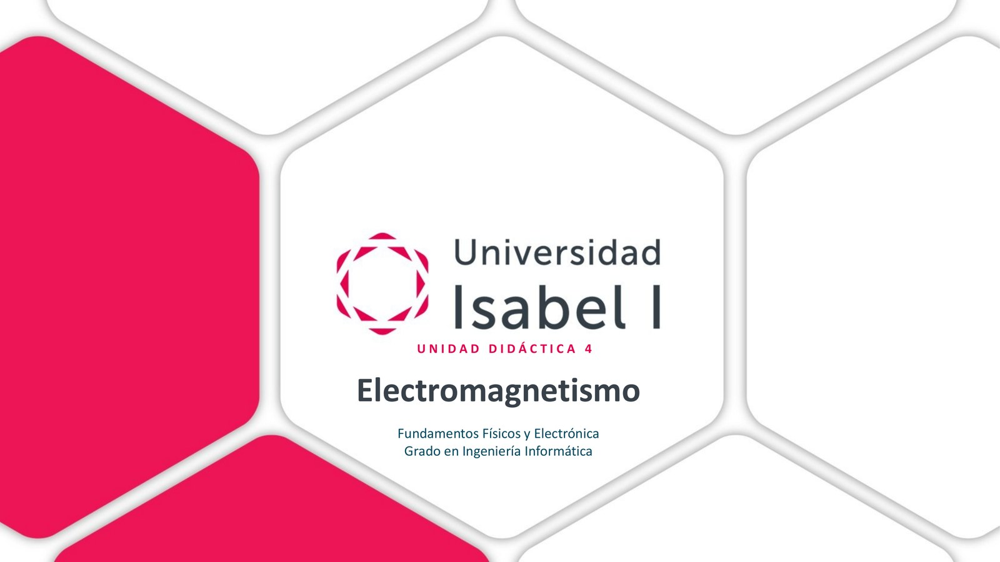

> Lo que pone la diapositiva: Universidad Isabel I. Unidad didáctica 4. Electromagnetismo. Fundamentos Físicos y Electrónica. Grado en Ingeniería Informática.

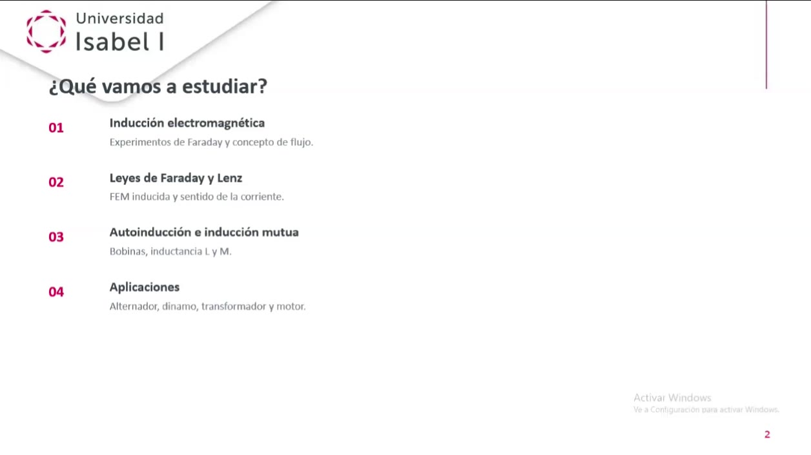

> Lo que pone la diapositiva: Título: ¿Qué vamos a estudiar? Punto 1: Inducción electromagnética. Experimentos de Faraday y concepto de flujo. Punto 2: Leyes de Faraday y Lenz. FEM inducida y sentido de la corriente. Punto 3: Autoinducción e inducción mutua. Bobinas, inductancia L y M. Punto 4: Aplicaciones. Alternador, dinamo, transformador y motor.

## La meta de la clase: entender un motor eléctrico

El profe enseñó primero el dibujo de un motor desmontado. Dijo que al principio asusta, pero que al final de la clase se entiende cada pieza.

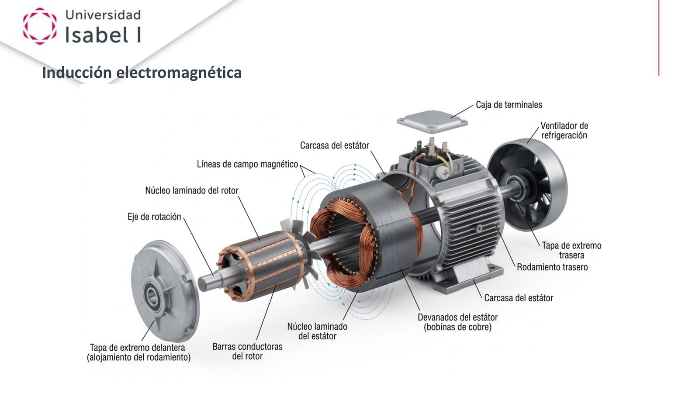

> Lo que pone la diapositiva: Título: Inducción electromagnética. Es el dibujo de un motor eléctrico desmontado, con sus piezas señaladas: caja de terminales, ventilador de refrigeración, carcasa del estátor, líneas de campo magnético, núcleo laminado del rotor, eje de rotación, tapa de extremo delantera (alojamiento del rodamiento), barras conductoras del rotor, núcleo laminado del estátor, devanados del estátor (bobinas de cobre), tapa de extremo trasera, rodamiento trasero y carcasa del estátor.

Lo que explicó del dibujo:

- Los cables se conectan en la caja de terminales. Pueden ser 2, 6 o 12 cables, según el tipo de motor.
- Hay una parte que NO se mueve: el estátor. Es la carcasa de fuera, con las bobinas de cobre.
- Hay una parte que SÍ gira: el rotor. Está en el centro y gira sobre un eje.
- Por eso hay una tapa a cada lado: sujetan el eje para que el rotor pueda girar.
- Lo que hay en el estátor y lo que hay en el rotor, juntos, es lo que hace girar el motor.

> Recuerda: Estátor = lo que está quieto. Rotor = lo que rota. Un truco: «estátor» se parece a «estático» y «rotor» se parece a «rotar».

## Inducción electromagnética: el experimento de Faraday

En 1831, Faraday demostró que un campo magnético puede producir corriente eléctrica.

El experimento es muy sencillo:

- Tienes una espira, o muchas vueltas de cable.
- La conectas a un galvanómetro. Un galvanómetro es un aparato que mide corriente. Tiene una aguja.
- Metes y sacas un imán por el medio de la espira.

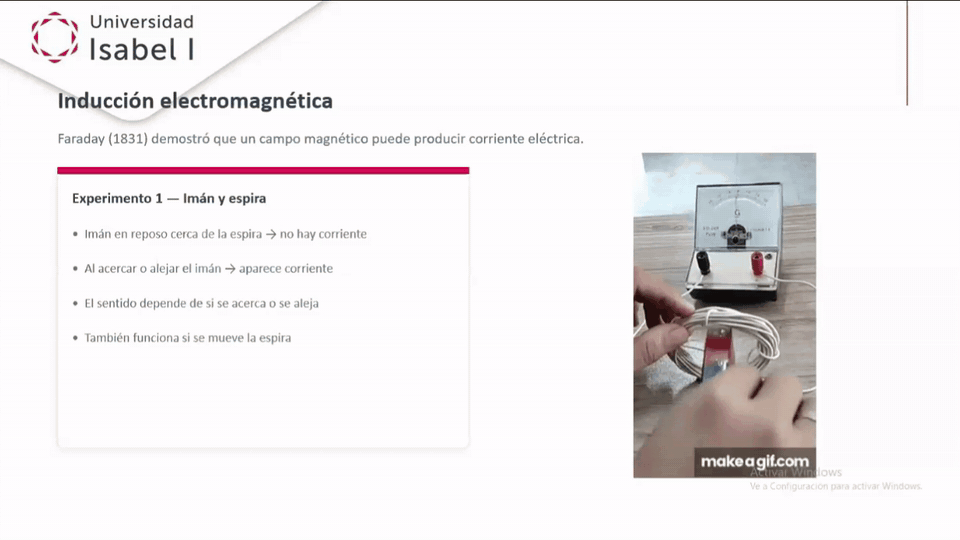

> Lo que pone la diapositiva: Título: Inducción electromagnética. Faraday, en 1831, demostró que un campo magnético puede producir corriente eléctrica. Cuadro: Experimento 1, imán y espira. Imán en reposo cerca de la espira: no hay corriente. Al acercar o alejar el imán: aparece corriente. El sentido depende de si se acerca o se aleja. También funciona si se mueve la espira. A la derecha, una animación: una mano mueve un imán dentro de una bobina de cable blanco y la aguja del galvanómetro se mueve.

Lo que pasa, paso a paso:

- 1. Si el imán está QUIETO dentro de la espira, la aguja no se mueve. No hay corriente.
- 2. Si ACERCAS el imán, la aguja se mueve hacia un lado. Hay corriente.
- 3. Si ALEJAS el imán, la aguja se mueve hacia el otro lado. Hay corriente, pero al revés.
- 4. Si dejas el imán quieto y mueves la espira, también aparece corriente.

La idea clave que repitió el profe: hace falta que algo se mueva. Da igual si se mueve el imán o la espira. Lo que importa es el movimiento de uno respecto del otro. A eso le llamó movimiento relativo.

Esta corriente que aparece en la espira tiene nombre: corriente inducida.

Y además es variable, no continua: va y viene según acercas y alejas el imán.

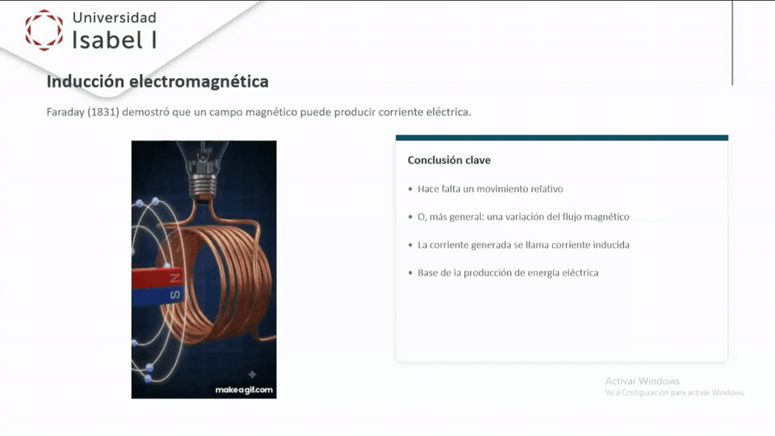

> Lo que pone la diapositiva: Título: Inducción electromagnética. Faraday, en 1831, demostró que un campo magnético puede producir corriente eléctrica. A la izquierda, una animación con el rótulo Faraday's law, ley de Faraday: un imán sube y baja dentro de una bobina de cobre. Cuadro: Conclusión clave. Hace falta un movimiento relativo. O, más general: una variación del flujo magnético. La corriente generada se llama corriente inducida. Base de la producción de energía eléctrica.

> Recuerda: Imán quieto = no hay corriente. Imán en movimiento = sí hay corriente. La corriente inducida es la base de cómo se produce la electricidad en las centrales.

> En el examen: Este experimento ha caído 3 veces en los registros. En el 18220: si el galvanómetro marca cero es porque por la espira no circula corriente. En el 2415630: la corriente inducida aumenta si la velocidad del imán aumenta. En el 12532 te piden la frase INCORRECTA, y la trampa es «cuanto más rápido, menos corriente» (es al revés: más rápido, más corriente).

## El flujo magnético

Para medir «cuánto campo magnético pasa por dentro de la espira» se usa el flujo magnético. Se escribe con la letra griega fi, Φ.

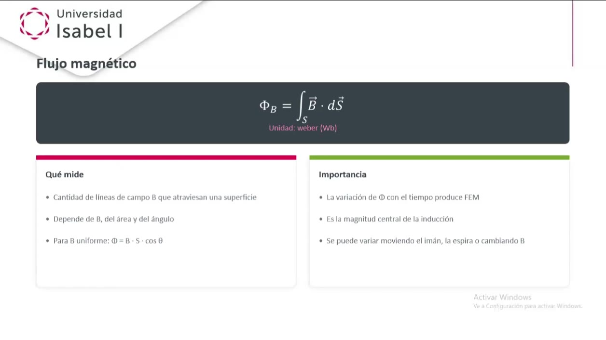

> Lo que pone la diapositiva: Título: Flujo magnético. Fórmula: fi sub be es igual a la integral sobre la superficie ese de be vectorial por de ese vectorial. Unidad: weber, Wb. Cuadro Qué mide: cantidad de líneas de campo B que atraviesan una superficie. Depende de B, del área y del ángulo. Para B uniforme: fi igual a be por ese por coseno de theta. Cuadro Importancia: la variación de fi con el tiempo produce FEM. Es la magnitud central de la inducción. Se puede variar moviendo el imán, la espira o cambiando B.

Lo que dijo el profe: el flujo cuenta cuántas líneas del campo magnético atraviesan la superficie de la espira.

La fórmula con la integral es la general. Para clase y examen basta la versión sencilla, cuando el campo es igual en toda la espira:

$ Φ = B · S · cos θ :: fi es igual a be, por ese, por el coseno de theta

Qué significa cada letra:

- Φ (fi): el flujo magnético. Se mide en weber, Wb.
- B: lo fuerte que es el campo magnético. Se mide en tesla, T.
- S: el área de la espira. Se mide en metros cuadrados, m².
- θ (theta): el ángulo entre el campo B y la línea perpendicular a la espira.

El profe preguntó: ¿y si el imán no entra recto, a 90° de la espira, sino inclinado, a 45° o a 30°? Pues entra menos campo. Eso lo hace el coseno.

### Un ejemplo con números

Mismo imán y misma espira. Solo cambiamos cómo está girada la espira.

Datos:

- B = 0,2 T
- S = 0,5 m²

Caso 1. La espira está de frente al campo (θ = 0°).

$ cos 0° = 1 :: coseno de cero grados es uno

$ Φ = 0,2 · 0,5 · 1 :: fi es cero coma dos, por cero coma cinco, por uno

$ Φ = 0,1 Wb :: fi es cero coma uno weber

Caso 2. La espira está inclinada (θ = 60°).

$ cos 60° = 0,5 :: coseno de sesenta grados es cero coma cinco

$ Φ = 0,2 · 0,5 · 0,5 :: fi es cero coma dos, por cero coma cinco, por cero coma cinco

$ Φ = 0,05 Wb :: fi es cero coma cero cinco weber. La mitad que antes.

Caso 3. La espira está de canto (θ = 90°).

$ cos 90° = 0 :: coseno de noventa grados es cero

$ Φ = 0,2 · 0,5 · 0 :: fi es cero coma dos, por cero coma cinco, por cero

$ Φ = 0 :: fi es cero. No la cruza ninguna línea.

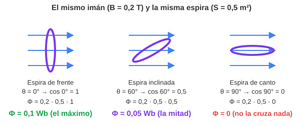

> Qué ves en el dibujo: Las flechas azules son las líneas del campo magnético. El óvalo morado es la espira. De frente la atraviesan todas las líneas y el flujo es el máximo, 0,1 Wb. Inclinada a 60° la atraviesan la mitad, 0,05 Wb. De canto no la atraviesa ninguna y el flujo es cero.

> En el examen: Esto ha caído 2 veces como la espira que gira (12532 y 18220): «¿en qué posición el flujo es máximo?». La respuesta es la posición en la que el vector normal de la espira está alineado con B (ángulo 0°). Dónde falla mucha gente: en esa posición la FEM vale cero, y se cree que el flujo también. No: el flujo es máximo justo cuando la FEM es cero.

### Las tres formas de cambiar el flujo

Como Φ = B · S · cos θ, el flujo cambia si cambia cualquiera de las tres cosas:

- 1. Cambiar B: mover el imán, o usar un imán cuya fuerza cambie. El profe dijo que un imán que puede cambiar su campo es un electroimán: una bobina con corriente.
- 2. Cambiar S: hacer la espira más grande o más pequeña.
- 3. Cambiar θ: girar la espira.

> En el examen: Ha caído 2 veces (2301140 y 2415630): «¿cuál es una causa de la variación del flujo magnético?». Respuesta: la variación del área del circuito.

> Ojo: En la grabación, al hablar del imán que cambia su campo, se oye «eso es un electrón». Lo que quiso decir es electroimán.

## La ley de Faraday

> Lo que pone la diapositiva: Título: Ley de Faraday. Fórmula: épsilon es igual a menos de fi sub eme entre de te. Fi sub eme es el flujo magnético. Cuadro Enunciado: la FEM inducida es proporcional a la rapidez con que cambia el flujo. Válida para una espira o para N espiras (ene por de fi entre de te). Base de generadores y transformadores. Cuadro Cómo variar el flujo: mover el imán o la bobina. Cambiar la intensidad de la corriente que crea B. Variar el área o la orientación de la espira. Abajo: FEM, fuerza electromagnética.

Primero, una palabra nueva: FEM. Es el «empuje» que hace moverse a la corriente, como el de una pila. Se mide en voltios, V. Se escribe con la letra épsilon, ε.

> Ojo: La diapositiva pone «FEM: Fuerza Electro Magnética», y en la grabación el profe también dice «fuerza electromagnética». El nombre correcto, y el que sale en los exámenes, es fuerza ELECTROMOTRIZ. Las siglas son las mismas: FEM.

Lo que dice la ley de Faraday, con palabras:

- La FEM inducida depende de lo RÁPIDO que cambia el flujo.
- Cambio lento = poca FEM.
- Cambio rápido = mucha FEM.
- Si el flujo no cambia, la FEM es cero.

$ ε = − ΔΦ / Δt :: épsilon es igual a menos el cambio de flujo, entre el tiempo que tarda en cambiar

El triángulo Δ (delta) significa «cuánto cambia». ΔΦ es cuánto cambia el flujo. Δt es cuánto tiempo tarda.

Con muchas vueltas de cable, N vueltas, la FEM se multiplica por N:

$ ε = − N · ΔΦ / Δt :: épsilon es igual a menos ene, por el cambio de flujo, entre el tiempo

### Un ejemplo con números

Empezamos con 17 ÷ 5 para ver la idea de «repartir en el tiempo»: si hay 17 caramelos para 5 días, tocan 3,4 cada día. Aquí es igual: el cambio de flujo se reparte entre el tiempo que tarda.

Datos: el flujo de la espira pasa de 0,1 Wb a 0 Wb (sacamos el imán) en 0,5 segundos.

Paso 1. Cuánto cambia el flujo.

$ ΔΦ = Φ final − Φ inicial :: el cambio de flujo es el flujo final menos el inicial

$ ΔΦ = 0 − 0,1 :: cero menos cero coma uno

$ ΔΦ = − 0,1 Wb :: menos cero coma uno weber

Paso 2. Dividir entre el tiempo.

$ ΔΦ / Δt = − 0,1 / 0,5 :: menos cero coma uno entre cero coma cinco

$ ΔΦ / Δt = − 0,2 :: menos cero coma dos

Paso 3. Poner el signo menos de la fórmula.

$ ε = − (− 0,2) :: épsilon es menos, por menos cero coma dos

$ ε = 0,2 V :: épsilon es cero coma dos voltios

Ahora lo mismo, pero sacando el imán más rápido: en 0,1 segundos.

$ ΔΦ / Δt = − 0,1 / 0,1 :: menos cero coma uno entre cero coma uno

$ ΔΦ / Δt = − 1 :: menos uno

$ ε = 1 V :: épsilon es un voltio. Cinco veces más que antes.

Y con una bobina de 100 vueltas, sacando el imán en 0,5 segundos:

$ ε = 100 · 0,2 :: cien por cero coma dos

$ ε = 20 V :: veinte voltios

> Recuerda: Más rápido = más FEM. Más vueltas = más FEM. Imán quieto = cero FEM.

El signo menos de la fórmula lo explicó el profe así: la FEM va «en contra», se resiste al cambio. Eso es la ley de Lenz, la siguiente.

> En el examen: La ley de Faraday ha caído 4 veces en los registros (2301140, 2401760, 2415630 y 12532). Respuestas de la plantilla: la FEM es proporcional a la variación del flujo magnético; y cuanto más rápido varíe el flujo, mayor es la FEM inducida, con sentido opuesto a la causa que la produce.

> Ojo: En el 2415630, la pregunta «según la ley de Faraday, ¿qué induce una FEM?» tiene como clave «el flujo magnético a través de cualquier superficie cerrada». Esa frase en realidad es la ley de Gauss del magnetismo, y lo que induce la FEM es la VARIACIÓN del flujo. La web guarda la clave oficial, pero tú quédate con la idea buena.

## La ley de Lenz: hacia dónde va la corriente

Faraday dice CUÁNTA FEM aparece. Lenz dice HACIA DÓNDE va la corriente. El profe dijo que Lenz es un complemento de Faraday.

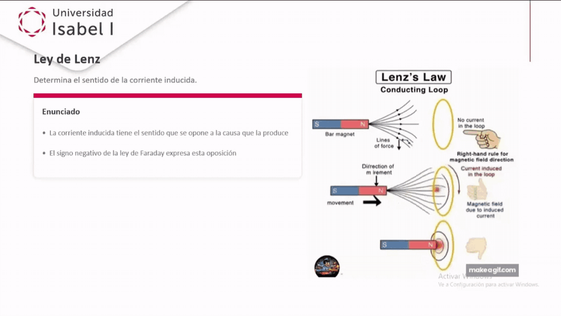

> Lo que pone la diapositiva: Título: Ley de Lenz. Determina el sentido de la corriente inducida. Cuadro Enunciado: la corriente inducida tiene el sentido que se opone a la causa que la produce. El signo negativo de la ley de Faraday expresa esta oposición. A la derecha, una animación en inglés, Lenz's law, conducting loop: arriba, el imán quieto y la espira sin corriente. En medio, el imán se mueve hacia la espira y aparece una corriente inducida y un campo magnético creado por esa corriente. Abajo, el imán muy cerca. Al lado, una mano que enseña la regla de la mano derecha para saber el sentido del campo.

Para saber el sentido usó la regla de la mano derecha de la unidad 3: cierras los dedos en el sentido en que gira la corriente por la espira, y el pulgar marca hacia dónde apunta el campo que crea.

### Por qué se opone: la idea del equilibrio

El profe lo explicó con la conservación de la energía. La naturaleza siempre intenta mantener el equilibrio. Puso dos ejemplos de casa:

- Si abres la ventana en invierno, el calor de casa se va hacia la calle hasta que las temperaturas se igualan.
- El agua siempre cae de la montaña hacia abajo, buscando el nivel del mar.

Con la espira pasa algo parecido. A la espira «no le gusta» que cambie el flujo que la atraviesa. Por eso:

- 1. El imán se mueve y cambia el flujo.
- 2. Aparece la corriente inducida.
- 3. Esa corriente crea su propio campo magnético.
- 4. Ese campo nuevo va EN CONTRA del cambio. Intenta frenarlo.

Dijo que la energía no se crea ni se destruye, solo se transforma. La corriente no sale gratis: para producirla hay que hacer fuerza contra la espira.

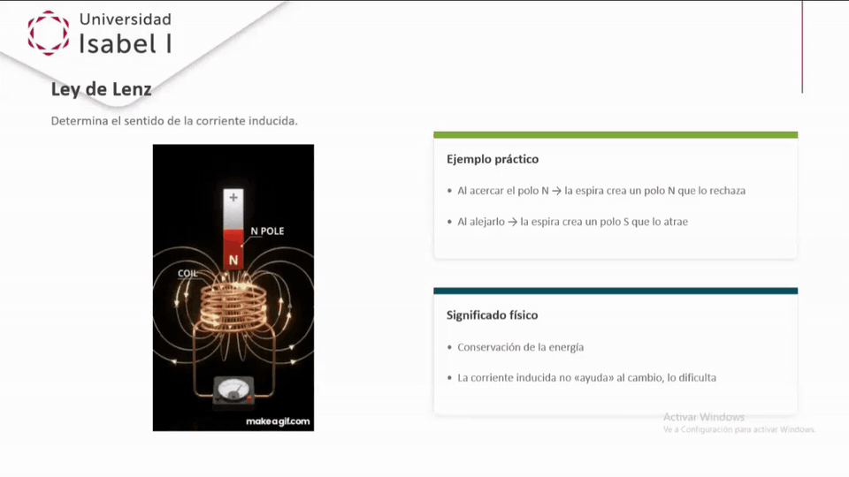

> Lo que pone la diapositiva: Título: Ley de Lenz. Determina el sentido de la corriente inducida. A la izquierda, una animación: un imán con el polo N abajo baja hacia una bobina, coil, conectada a un galvanómetro. Cuadro Ejemplo práctico: al acercar el polo N, la espira crea un polo N que lo rechaza. Al alejarlo, la espira crea un polo S que lo atrae. Cuadro Significado físico: conservación de la energía. La corriente inducida no «ayuda» al cambio, lo dificulta.

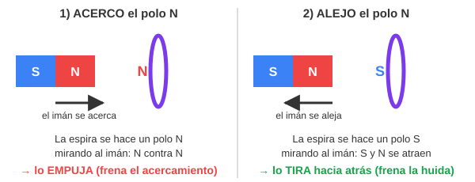

> Qué ves en el dibujo: A la izquierda, el imán se acerca a la espira con el polo norte delante. La espira se convierte en un polo norte mirando al imán. Norte contra norte se repelen: la espira empuja al imán y frena el acercamiento. A la derecha, el imán se aleja. Ahora la espira se convierte en polo sur. Sur y norte se atraen: la espira tira del imán y frena la huida. En los dos casos, la espira lleva la contraria.

> Recuerda: Lenz en una frase: la corriente inducida se OPONE a la causa que la produce. Si el flujo sube, ella intenta bajarlo. Si el flujo baja, ella intenta subirlo.

> En el examen: Lenz ha caído 4 veces en los registros (2301140, 2312920 y dos en el 2415630). Respuestas de la plantilla: la corriente inducida se opone a la variación del flujo magnético; y su sentido es el opuesto a la causa que la produce.

## Autoinducción: la bobina se frena a sí misma

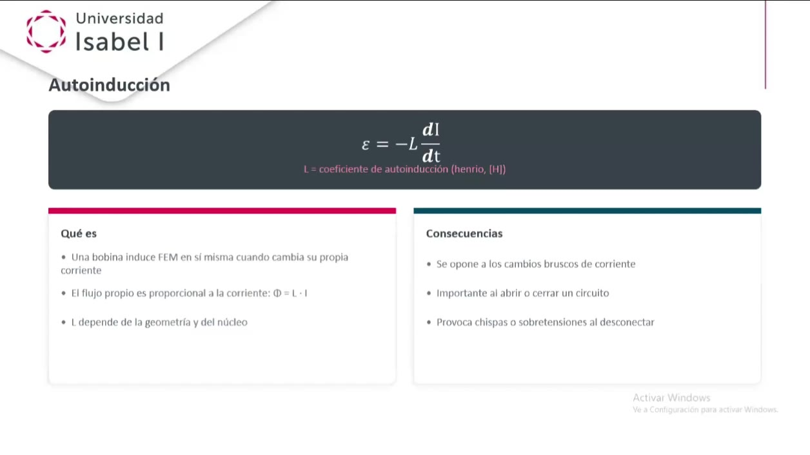

> Lo que pone la diapositiva: Título: Autoinducción. Fórmula: épsilon es igual a menos ele por de i entre de te. Ele es el coeficiente de autoinducción, en henrios, H. Cuadro Qué es: una bobina induce FEM en sí misma cuando cambia su propia corriente. El flujo propio es proporcional a la corriente: fi igual a ele por i. Ele depende de la geometría y del núcleo. Cuadro Consecuencias: se opone a los cambios bruscos de corriente. Importante al abrir o cerrar un circuito. Provoca chispas o sobretensiones al desconectar.

Hasta ahora, el campo venía de un imán de fuera. Pero una bobina con corriente también crea su propio campo. Si su corriente cambia, su propio flujo cambia… y se induce una FEM en ella misma. Eso es la autoinducción.

$ ε = − L · ΔI / Δt :: épsilon es igual a menos ele, por el cambio de corriente, entre el tiempo

Qué significa cada letra:

- ε: la FEM autoinducida, en voltios.
- L: el coeficiente de autoinducción. Se mide en henrios, H. Depende de la forma de la bobina y de su núcleo.
- ΔI / Δt: lo rápido que cambia la corriente, en amperios por segundo.
- El signo menos: otra vez Lenz. La FEM va en contra del cambio de corriente.

### Un ejemplo con números

Datos: una bobina con L = 0,5 H. Su corriente sube de 0 A a 2 A en 0,1 segundos.

Paso 1. Cuánto cambia la corriente.

$ ΔI = 2 − 0 :: dos menos cero

$ ΔI = 2 A :: dos amperios

Paso 2. Lo rápido que cambia.

$ ΔI / Δt = 2 / 0,1 :: dos entre cero coma uno

$ ΔI / Δt = 20 A/s :: veinte amperios por segundo

Paso 3. La FEM.

$ ε = − 0,5 · 20 :: menos cero coma cinco por veinte

$ ε = − 10 V :: menos diez voltios

El signo menos dice que esos 10 V empujan EN CONTRA de la subida de la corriente.

> En el examen: La autoinducción ha caído 3 veces en los registros. En el 2312920 te dan la fórmula: ε = − L dI/dt. En el 2312920 también: al encender o apagar un circuito de corriente continua se produce una FEM autoinducida. En el 2502310: la autoinducción es cuando un circuito genera una FEM contra el cambio de corriente.

## Al abrir y cerrar un circuito

Al final de la clase el profe volvió a la autoinducción con esta diapositiva:

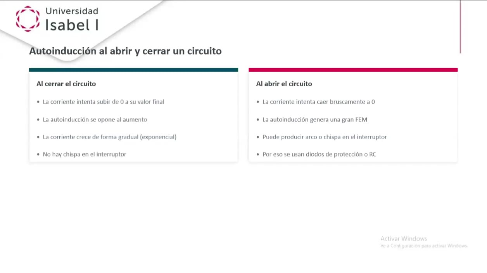

> Lo que pone la diapositiva: Título: Autoinducción al abrir y cerrar un circuito. Cuadro Al cerrar el circuito: la corriente intenta subir de 0 a su valor final. La autoinducción se opone al aumento. La corriente crece de forma gradual (exponencial). No hay chispa en el interruptor. Cuadro Al abrir el circuito: la corriente intenta caer bruscamente a 0. La autoinducción genera una gran FEM. Puede producir arco o chispa en el interruptor. Por eso se usan diodos de protección o RC.

- Al CERRAR (encender): la corriente quiere subir de golpe. La autoinducción la frena. Sube poco a poco. No hay chispa.
- Al ABRIR (apagar): la corriente quiere caer a cero de golpe. Como el cambio es muy rápido, la FEM autoinducida es enorme. Puede saltar una chispa en el interruptor.
- Por eso se ponen protecciones: diodos de protección, circuitos RC o relés.

Puso el ejemplo de la alta tensión: al abrir un interruptor en una central, la tensión es tan alta que el aire, que normalmente aísla, deja pasar la corriente. Salta un arco eléctrico, como un pequeño rayo. Es lo mismo que pasa con los relámpagos.

> Recuerda: Encender = sube poco a poco, sin chispa. Apagar = cambio brusco, FEM grande, puede haber chispa.

## Inducción mutua: una bobina induce a otra

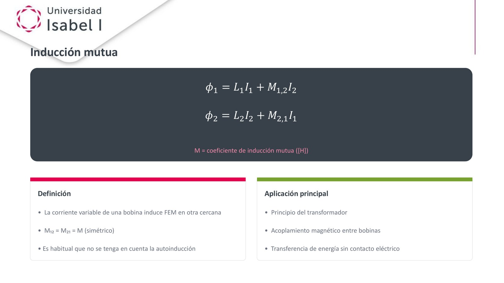

> Lo que pone la diapositiva: Título: Inducción mutua. Fórmulas: fi uno es igual a ele uno por i uno, más eme uno dos por i dos. Fi dos es igual a ele dos por i dos, más eme dos uno por i uno. Eme es el coeficiente de inducción mutua, en henrios. Cuadro Definición: la corriente variable de una bobina induce FEM en otra cercana. Eme uno dos es igual a eme dos uno, que es igual a eme (simétrico). Es habitual que no se tenga en cuenta la autoinducción. Cuadro Aplicación principal: principio del transformador. Acoplamiento magnético entre bobinas. Transferencia de energía sin contacto eléctrico.

Ahora hay dos bobinas cerca, sin tocarse:

- 1. Por la bobina 1 pasa una corriente que cambia.
- 2. Esa corriente crea un campo magnético que cambia.
- 3. Ese campo llega a la bobina 2 y cambia su flujo.
- 4. En la bobina 2 aparece una corriente inducida, sin cable entre las dos.
- 5. Y la bobina 2 también influye de vuelta en la bobina 1.

Qué dicen las fórmulas de la diapositiva, con palabras: el flujo de cada bobina tiene dos partes. Una parte es por su propia corriente (eso es L, la autoinducción). La otra parte es por la corriente de la otra bobina (eso es M, la inducción mutua).

El profe dijo que M es igual para las dos bobinas (simétrico) y que no iba a entrar en más detalle.

> Recuerda: Autoinducción (L) = una bobina sobre sí misma. Inducción mutua (M) = una bobina sobre otra cercana. La inducción mutua es la base del transformador.

> En el examen: La inducción mutua con estas palabras no ha caído en los exámenes registrados. Sí sale el transformador en el temario, pero tampoco hay preguntas de transformador en los registros.

## Aplicaciones: el alternador

El profe dijo que no sirve de nada saber leyes si no sabemos para qué se usan. Primera aplicación: el alternador.

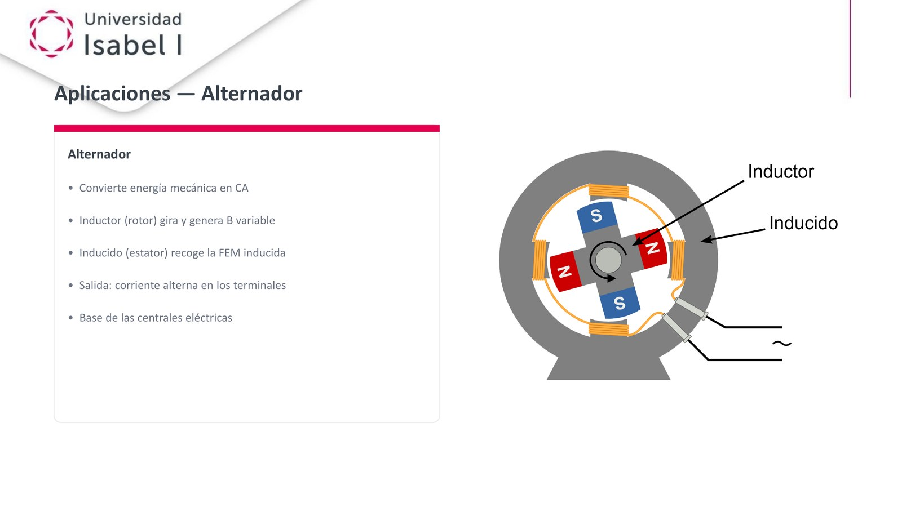

> Lo que pone la diapositiva: Título: Aplicaciones, alternador. Cuadro: Alternador. Convierte energía mecánica en CA, corriente alterna. Inductor (rotor) gira y genera B variable. Inducido (estátor) recoge la FEM inducida. Salida: corriente alterna en los terminales. Base de las centrales eléctricas. A la derecha, el dibujo: un rotor en cruz con imanes N, S, N, S que gira, señalado como inductor, dentro de un anillo gris con bobinas, señalado como inducido, y dos cables de salida con el símbolo de corriente alterna.

- Entra movimiento (energía mecánica) y sale electricidad (corriente alterna).
- El INDUCTOR es la parte que gira (el rotor, con los imanes). Crea el campo que cambia.
- El INDUCIDO es la parte quieta (el estátor, con las bobinas). Ahí aparece la FEM inducida.

Así funcionan las centrales: en una presa, el agua cae, mueve unas palas, las palas hacen girar el rotor y el alternador produce corriente alterna.

> En el examen: El alternador ha caído 2 veces. En el 18220: sus partes fundamentales son inductor e inducido. En el 2401760: la función del inductor es rotar los pares de polos de forma alterna.

## Aplicaciones: la dinamo de la bicicleta

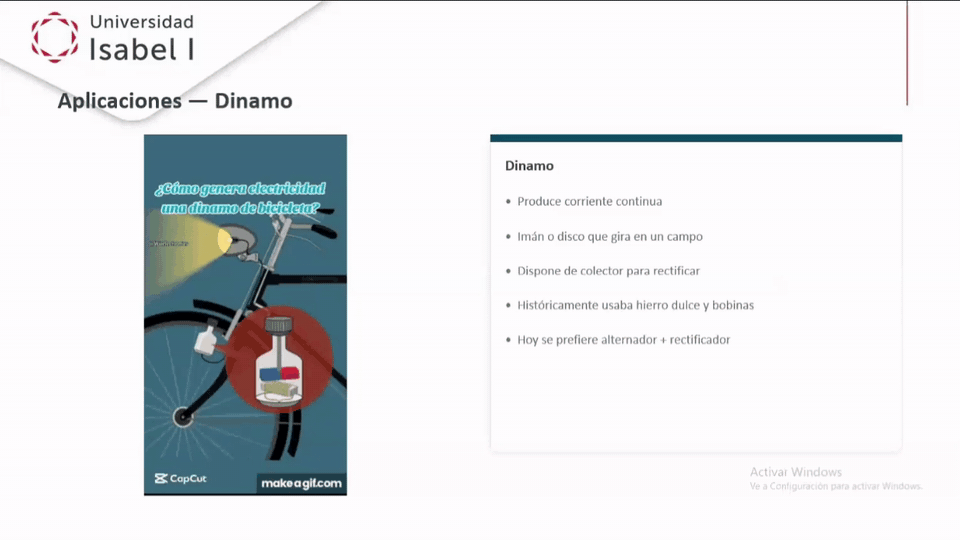

> Lo que pone la diapositiva: Título: Aplicaciones, dinamo. A la izquierda, una animación con el título ¿Cómo genera electricidad una dinamo de bicicleta?: la rueda gira, hace girar un imán dentro de la dinamo y se enciende la luz. Cuadro: Dinamo. Produce corriente continua. Imán o disco que gira en un campo. Dispone de colector para rectificar. Históricamente usaba hierro dulce y bobinas. Hoy se prefiere alternador más rectificador.

- La rueda de la bici hace girar un imán pequeño cerca de una bobina.
- En la bobina aparece una corriente pequeña, suficiente para encender una bombilla.
- La dinamo da corriente CONTINUA porque tiene un colector que «rectifica»: le da la vuelta a la corriente para que vaya siempre en el mismo sentido.
- Hoy se usa más un alternador con un rectificador, porque es más sencillo y gasta menos.

> En el examen: La dinamo ha caído 3 veces. En el 2502310: produce corriente continua. En el 18220, dos preguntas: su fundamento es el rectificador de corriente; y es un dispositivo que rectifica la corriente alterna para convertirla en continua.

> Recuerda: Alternador → corriente ALTERNA. Dinamo → corriente CONTINUA (gracias al rectificador).

## Aplicaciones: el transformador

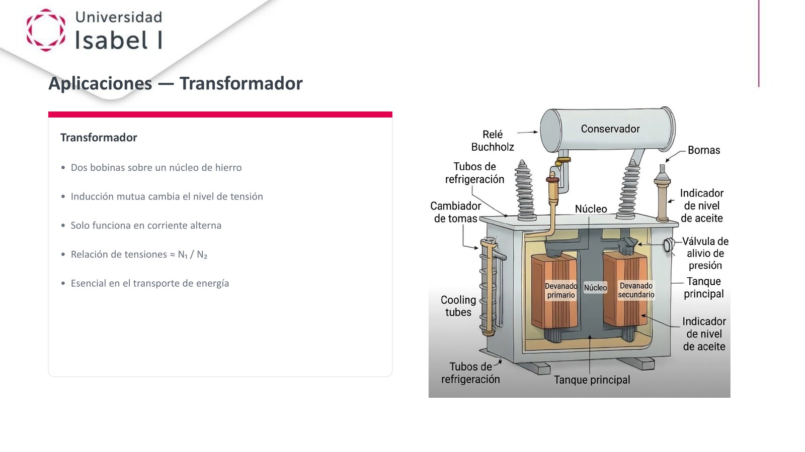

> Lo que pone la diapositiva: Título: Aplicaciones, transformador. Cuadro: Transformador. Dos bobinas sobre un núcleo de hierro. Inducción mutua cambia el nivel de tensión. Solo funciona en corriente alterna. Relación de tensiones aproximadamente igual a ene uno entre ene dos. Esencial en el transporte de energía. A la derecha, el dibujo de un transformador grande con sus partes: conservador, relé Buchholz, bornas, tubos de refrigeración, cambiador de tomas, núcleo, devanado primario, devanado secundario, indicador de nivel de aceite, válvula de alivio de presión y tanque principal.

Cómo lo explicó el profe:

- Las líneas de alta tensión (las torres grandes junto a la autovía) llevan una tensión muy alta. No es la que usamos en casa.
- Hay que bajarla por pasos: de alta a media tensión, y de media a baja, que es la de casa.
- Eso lo hace el transformador: dos bobinas (se llaman devanados porque tienen miles de vueltas) sobre un núcleo de hierro.
- El devanado primario recibe la corriente y crea un flujo que cambia. Ese flujo induce corriente en el devanado secundario. Es inducción mutua.
- Como las dos bobinas tienen distinto número de vueltas, la tensión de salida es distinta.
- Solo funciona con corriente alterna, porque hace falta que el flujo cambie.

$ V₁ / V₂ = N₁ / N₂ :: uve uno entre uve dos es igual a ene uno entre ene dos

### Un ejemplo con números

Datos: entran 230 V en el primario. El primario tiene 1000 vueltas y el secundario 50.

Paso 1. Despejar V₂.

$ V₂ = V₁ · N₂ / N₁ :: uve dos es uve uno, por ene dos, entre ene uno

Paso 2. Poner los números.

$ V₂ = 230 · 50 / 1000 :: doscientos treinta, por cincuenta, entre mil

$ V₂ = 11 500 / 1000 :: once mil quinientos entre mil

$ V₂ = 11,5 V :: once coma cinco voltios

Menos vueltas en el secundario = menos tensión a la salida.

### Por qué se transporta la electricidad en alta tensión

El profe se salió un poco del tema para explicarlo. La idea: con más tensión, hace falta menos corriente para llevar la misma energía. Y con menos corriente, los cables se calientan menos y se pierde menos energía por el camino.

Ejemplo con números. Queremos llevar 1000 W.

$ P = V · I :: potencia es tensión por corriente

Con 100 V:

$ I = 1000 / 100 :: mil entre cien

$ I = 10 A :: diez amperios

Con 10 000 V:

$ I = 1000 / 10 000 :: mil entre diez mil

$ I = 0,1 A :: cero coma uno amperios. Cien veces menos corriente.

> Ojo: En la grabación el profe dice «se usa alta tensión porque la resistencia baja». Lo que baja no es la resistencia: baja la CORRIENTE, y por eso hay menos pérdidas por calor (efecto Joule). También dice que en casa hay 220 V a 60 Hz; en España la red es de 230 V y 50 Hz.

También dijo que los cargadores de móvil hacen algo parecido: bajan los 230 V de alterna a 5 V de continua.

## Aplicaciones: el motor eléctrico

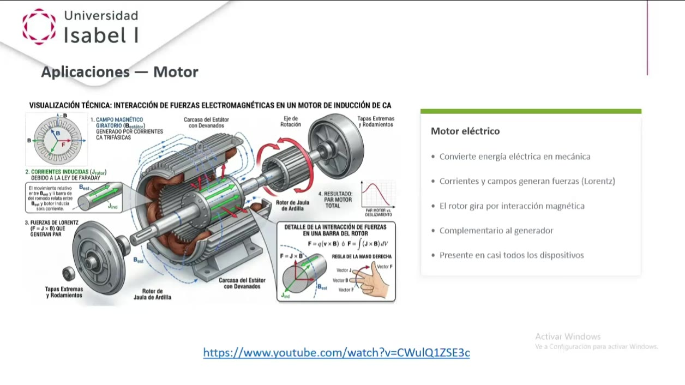

> Lo que pone la diapositiva: Título: Aplicaciones, motor. A la izquierda, un dibujo técnico: Visualización técnica, interacción de fuerzas electromagnéticas en un motor de inducción de corriente alterna. Punto 1: campo magnético giratorio, B del estátor, generado por corrientes alternas trifásicas. Punto 2: corrientes inducidas en el rotor debido a la ley de Faraday. Punto 3: fuerzas de Lorentz, efe igual a jota vectorial be, que generan par. Punto 4: resultado, par motor total. Abajo, un detalle de la regla de la mano derecha: efe igual a cu por uve vectorial be. Cuadro Motor eléctrico: convierte energía eléctrica en mecánica. Corrientes y campos generan fuerzas (Lorentz). El rotor gira por interacción magnética. Complementario al generador. Presente en casi todos los dispositivos. Abajo, el enlace a un vídeo de YouTube.

- El motor hace lo contrario que el alternador: entra electricidad y sale movimiento.
- Se conecta la electricidad al estátor. El estátor crea un campo magnético.
- Las corrientes y los campos crean fuerzas (la fuerza de Lorentz de la unidad 3). Esas fuerzas hacen girar el rotor.
- Está en casi todo lo que gira en casa: batidora, ventilador, lavadora, secador…
- Un mismo motor puede funcionar al revés, como generador. Según cómo esté diseñado, es mejor en un sentido o en el otro.

El profe dijo que lo maravilloso del motor es que junta todo lo visto en el electromagnetismo en una sola máquina.

> Vídeo: El profe enseñó en clase un vídeo de YouTube, «¿Cómo funciona un motor eléctrico? (Motor de CC)», de Jared Owen. Lo recomendó «encarecidamente». Pidió empezar a verlo hacia el minuto 1:25, en la parte de los fundamentos del magnetismo, aunque se puede ver entero. Está en inglés, con subtítulos y doblaje en español. Está justo debajo de su diapositiva.

> Recuerda: Alternador: movimiento → electricidad. Motor: electricidad → movimiento. Son complementarios.

El profe dijo que no le dio tiempo a explicar el motor entero. Intentará seguir en la próxima clase.

## Aplicaciones cercanas: el cargador inalámbrico del móvil

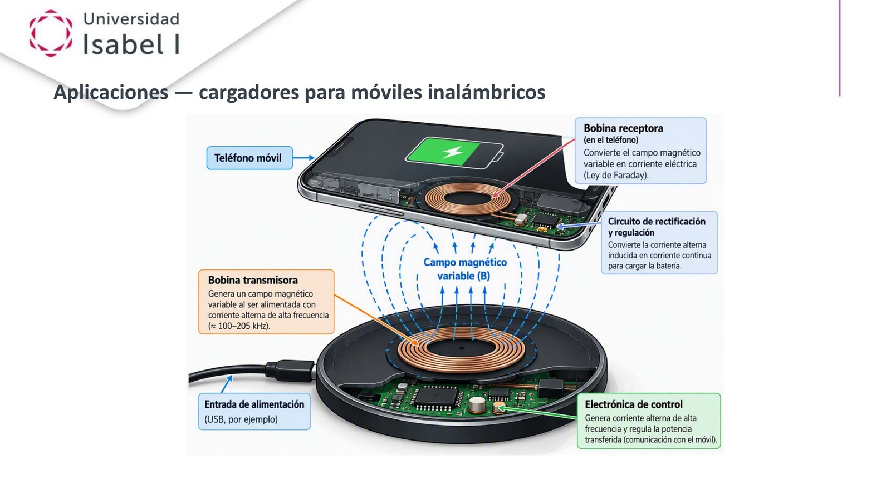

> Lo que pone la diapositiva: Título: Aplicaciones, cargadores para móviles inalámbricos. Dibujo de un móvil encima de una base de carga. Bobina transmisora: genera un campo magnético variable al ser alimentada con corriente alterna de alta frecuencia, aproximadamente de 100 a 205 kilohercios. Campo magnético variable, B, entre las dos. Bobina receptora, en el teléfono: convierte el campo magnético variable en corriente eléctrica, ley de Faraday. Circuito de rectificación y regulación: convierte la corriente alterna inducida en corriente continua para cargar la batería. Electrónica de control: genera la corriente alterna de alta frecuencia y regula la potencia transferida. Entrada de alimentación: USB, por ejemplo.

- En la base hay una bobina (bobina transmisora). Por ella pasa corriente alterna, que crea un campo magnético que cambia.
- En el móvil hay otra bobina (bobina receptora). Ese campo que cambia induce en ella una corriente.
- Es inducción mutua: la energía pasa de una bobina a otra sin cable, solo acercando el móvil.

> Recuerda: Una bobina es simplemente un grupo grande de espiras, muchas vueltas de cable.

## Aplicaciones cercanas: la cocina de inducción

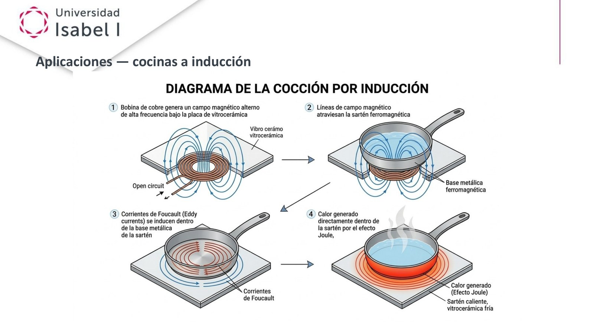

> Lo que pone la diapositiva: Título: Aplicaciones, cocinas a inducción. Diagrama de la cocción por inducción en cuatro pasos. Paso 1: una bobina de cobre genera un campo magnético alterno de alta frecuencia bajo la placa de vitrocerámica. Paso 2: las líneas de campo magnético atraviesan la sartén ferromagnética. Paso 3: corrientes de Foucault, en inglés eddy currents, se inducen dentro de la base metálica de la sartén. Paso 4: calor generado directamente dentro de la sartén por el efecto Joule. Sartén caliente, vitrocerámica fría.

En la clase 3 el profe dejó esta explicación a medias. Ahora, con Faraday, la terminó:

- 1. Debajo del cristal hay una bobina de cobre con corriente alterna de muy alta frecuencia. Crea un campo magnético que cambia muy deprisa.
- 2. Ese campo atraviesa la base de la sartén, que tiene que ser de un material ferromagnético (como el hierro).
- 3. La base no es una espira fina: es un bloque grande de metal. Dentro se forman muchas corrientes pequeñas en todas direcciones. Se llaman corrientes de Foucault, o corrientes parásitas.
- 4. Esas corrientes calientan el metal (efecto Joule). Por eso se calienta la sartén y no el cristal.

> Ojo: En la grabación el profe dice que la sartén puede ser «de metal, da lo mismo». No da lo mismo: tiene que ser ferromagnética. Una sartén solo de aluminio o de cobre no funciona en una placa de inducción. La propia diapositiva dice «sartén ferromagnética».

## Ideas clave

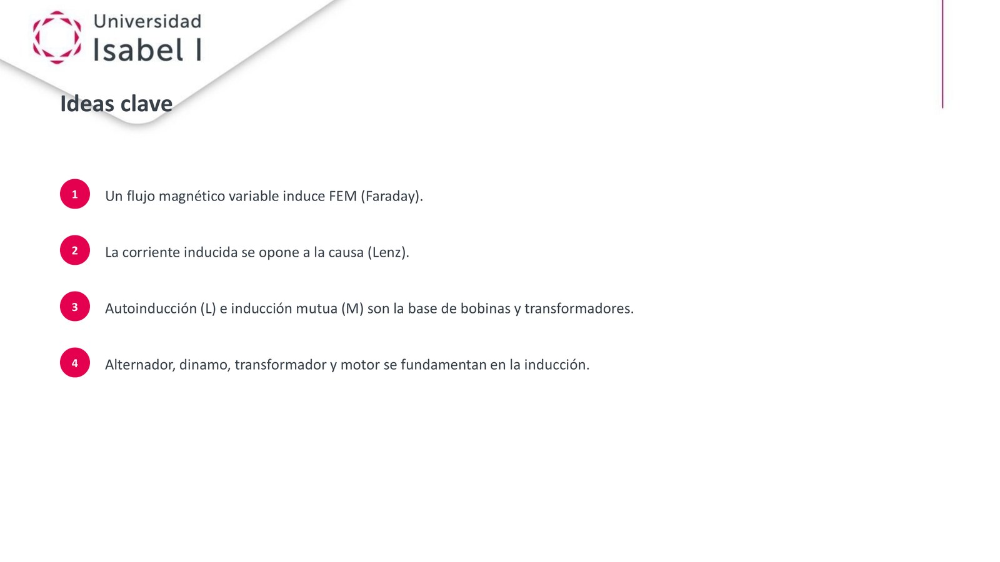

> Lo que pone la diapositiva: Título: Ideas clave. 1: un flujo magnético variable induce FEM (Faraday). 2: la corriente inducida se opone a la causa (Lenz). 3: autoinducción (ele) e inducción mutua (eme) son la base de bobinas y transformadores. 4: alternador, dinamo, transformador y motor se fundamentan en la inducción.

El resumen del profe al despedirse:

- Flujo que cambia → aparece FEM (Faraday).
- La corriente inducida va en contra de lo que la causa (Lenz).
- L y M son la base de bobinas y transformadores.
- Alternador, dinamo, transformador y motor funcionan gracias a la inducción.
- El cargador inalámbrico y la placa de inducción son ejemplos del día a día.

Pidió repasar la presentación, ver sobre todo el vídeo del motor, leer los apuntes de la unidad y preguntar dudas en el foro.

## Qué entra en el examen (resumen)

Esto es lo que hay en los 7 exámenes oficiales registrados, en la UD4:

- Ley de Faraday: 4 veces. Y el experimento del imán y la espira: 3 veces más.
- Ley de Lenz: 4 veces.
- Autoinducción: 3 veces.
- Dinamo: 3 veces.
- Alternador: 2 veces.
- Causas de que cambie el flujo: 2 veces.
- Posición de flujo máximo de la espira que gira: 2 veces.
- Transformador, inducción mutua, motor, cargador inalámbrico y cocina de inducción: 0 veces en los registros.
- El resto de preguntas de la UD4 son de ondas electromagnéticas y ecuaciones de Maxwell, que son de la próxima clase.

> En el examen: Es lo que hay en los registros, sin garantías. Lo que más se repite es lo que más tienes que dominar: Faraday, Lenz, autoinducción y dinamo.
